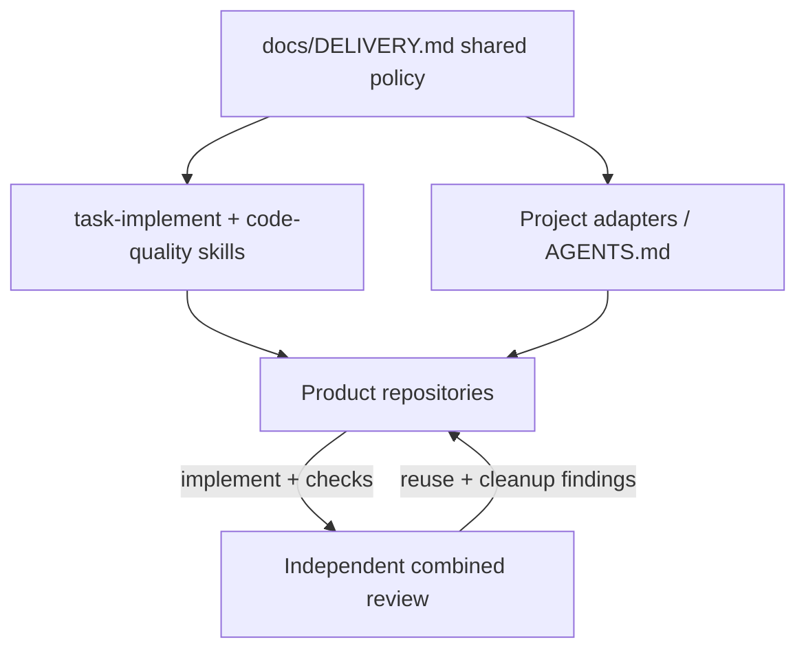

# Implementation-First Reuse and Evidence-Based Cleanup

## What Was Built

The public [agentic-workflow](https://github.com/okfriansyah-moh/agentic-workflow) repository
ships a single delivery policy in `docs/DELIVERY.md` that applies to Codex, Cursor AI, Claude
Code, and GitHub Copilot. [Merged PR #1](https://github.com/okfriansyah-moh/agentic-workflow/pull/1)
(2026-10-23) added a **Reuse and evidence-based cleanup** section and wired it into the
`task-implement` and `code-quality` skills, project adapters, and the bundle manifest so
implementation and review share one rule set instead of per-project copies.

Downstream products (for example [SpoolIn PR #16](https://github.com/okfriansyah-moh/spoolIn/pull/16))
pin bundle **1.3.0** and link local prompts to the shared policy rather than duplicating cleanup
guidance in every repository.

[Merged PR #2](https://github.com/okfriansyah-moh/agentic-workflow/pull/2) (2026-10-28) ships
**bundle 1.4.0** with **permanent quality guardrails**: each runtime component must produce
component-owned Docker test reports, meet **≥80%** unit and changed executable-line coverage,
publish Sonar results with **≥80%** combined/line coverage, and show **exact-zero** security,
reliability, duplicated-line, and duplicated-block counts before feature acceptance completes.
Skills, adapters, and planning/implementation/verification flows reference the same policy;
scaffolds stay blocked until configured. [SpoolIn PR #17](https://github.com/okfriansyah-moh/spoolIn/pull/17)
adopts 1.4.0 in the product repository and demonstrates the six-component gate matrix.

## The Problem

Agent-assisted repositories accumulate duplicate helpers, parallel prompt directories, and
“cleanup” commits that delete code an operator still needs. Without a shared policy:

1. **Implementers add before they search** — new files appear beside existing owners.
2. **Documentation drifts** — the same rule is copied into skills, prompts, and README fragments.
3. **Deletion is guesswork** — a missing text reference or matching hash is treated as proof a
   module is unused.
4. **Reviewers disagree** — implementation and quality skills cite different cleanup standards.
5. **Acceptance drifts to quick checks** — without registered component metrics, agents can claim
   “done” while individual services still fail coverage, duplication, or security analyzers.

## Why This Problem Is Difficult

1. **Boundaries differ by layer** — frontend list-return state, MCP review guards, and Catalog
   seed classes each have valid service ownership; blind deduplication can break transactions or
   public contracts.
2. **Framework discovery** — Spring components, SvelteKit routes, and generated contracts are not
   always reachable through static import graphs alone.
3. **Agent incentives** — models prefer “clean slate” files because they are easier to reason about
   in one turn.
4. **Cross-repo bundles** — pinned `.ai/bundles/` copies must stay digest-aligned when the upstream
   policy changes.
5. **Final acceptance is read-only** — bundle 1.4.0 revalidates registered full-gate evidence and
   retained test outputs without silently re-running suites, so stale or missing artifacts must fail closed.

## Beginner Mental Model

Treat the repository like a library with a **card catalog** (`DELIVERY.md`):

- Before writing a new chapter, **search the shelf** for an existing book on the topic.
- If a topic already has a book, **add a footnote link** instead of photocopying the chapter into
  another binder.
- Before throwing a book away, **check who still borrows it** (imports, tests, ops scripts, config),
  not just whether your note forgot to mention it.
- Before stamping “approved,” **collect report cards from every classroom** (frontend, Core, Catalog,
  Media, support services, MCP) — not one averaged grade for the whole school.

## Requirements and Constraints

| Requirement | Policy source |
| ----------- | ------------- |
| Search before add | Extend or reuse when behavior and responsibility match |
| One owner per documented topic | Link from prompts/skills; do not copy rules |
| Scoped deletion | Only within the approved selection; preserve contracts and fixtures |
| Consumer evidence | Imports, tests, generation, ops entry points, and requirements — not hash-only guesses |
| Review alignment | Combined reviewer checks reuse boundaries and deletion consumers |
| No global path mandates | Project directories remain project conventions |
| Per-component Docker reports | Each runtime component publishes measured inputs (bundle 1.4.0) |
| Coverage and Sonar floors | ≥80% unit/changed-line and analyzer combined/line; exact-zero issue counts |
| Registered delivery evidence | Final acceptance reads retained outputs; missing/stale evidence blocks completion |
| Scaffold gating | Unconfigured components cannot pass acceptance until reports exist |

## Architecture Overview



## Execution Flow

1. Coordinator loads the approved outcome and only the guidance needed for the selected work.
2. Before adding a file, function, dependency, or document, the implementer searches for an
   existing owner in the **current project**.
3. Repeated business rules are shared inside the correct boundary (for example a shared
   `frontend/src/lib/state/list-return.ts` module used by movie and person flows).
4. Documented topics keep **one owning source**; other artifacts link to it.
5. Removal happens only after consumer checks across imports, framework wiring, tests, and ops
   scripts; uncertain candidates stay in the findings ledger.
6. The combined reviewer validates reuse boundaries, deletion consumers, and affected behavior
   after agreed checks run.
7. For bundle **1.4.0**, each runtime component runs its Docker unit suite and publishes coverage/Sonar
   inputs; the gate runner blocks completion when any component is below threshold or reports nonzero
   security/reliability/duplication counters.
8. Final acceptance re-reads registered full-delivery artifacts — it does not silently re-launch suites.

## Important Components

| Component | Responsibility |
| --------- | -------------- |
| `docs/DELIVERY.md` | Canonical reuse and cleanup rules |
| `skills/task-implement/SKILL.md` | Points implementers at the shared policy |
| `skills/code-quality/SKILL.md` | Points reviewers at the same policy |
| `adapters/AGENTS.md` | Routes project agents through shared delivery text |
| `manifest.json` | Skill digests stay aligned when policy sections change |
| Project `.ai/bundles/<version>/` | Pinned copy consumed by product repos (e.g. SpoolIn 1.4.0) |
| Bundle **1.4.0** quality policy | Per-component Docker reports, coverage floors, Sonar exact-zero publication |
| Gate runner / acceptance skills | Fail closed on missing, stale, or weak component evidence |

## Simplified Implementation Examples

```markdown
<!-- Prefer link over copy in a project prompt -->
Before adding a new list-return helper, extend `frontend/src/lib/state/list-return.ts`
and follow [DELIVERY.md reuse rules](https://github.com/okfriansyah-moh/agentic-workflow/blob/main/docs/DELIVERY.md#reuse-and-evidence-based-cleanup).
```

```typescript
// simplified — shared module pattern (SpoolIn PR #16)
// movie/list-return.ts and person/write/list-return.ts import from lib/state/list-return.ts
import { createListReturnStore } from '$lib/state/list-return';
```

## Reliability and Idempotency

Policy changes are **documentation and skill wiring** — they do not mutate runtime services.
Bundle pins are updated through the official updater so `manifest.json` digests and discovery
links stay consistent across reinstalls. Personal skill overrides and existing project pins remain
until an operator explicitly updates them (per PR #1 evidence).

## Failure Modes

| Failure | Detection | Recovery |
| ------- | --------- | -------- |
| Duplicate prompt directories | Repository hygiene checks (SpoolIn `repository-hygiene.mjs`) | Consolidate paths and update references together |
| Over-aggressive deletion | Failing tests or missing ops entry points | Restore from Git; record evidence in findings ledger |
| Policy drift between repos | Stale bundle digest vs upstream `DELIVERY.md` | Re-run bundle update; link instead of copying |
| Review without consumer checks | Reviewer accepts hash-only deletion rationale | Reject; require import/test/ops evidence |

## Trade-offs and Rejected Alternatives

| Choice | Why |
| ------ | --- |
| Central policy vs per-repo essays | Central `DELIVERY.md` scales to many hosts; local copies rot quickly |
| Link vs copy in skills | Links keep one edit surface; copying was the pre-PR #1 failure mode |
| No global directory mandate | SpoolIn keeps `docs/prompts/`; other repos may differ — policy governs behavior, not paths |
| Rejected: blanket duplicate-file bans | Policy explicitly avoids extra audit frameworks; use existing lint/hygiene checks |

## Testing

PR #1 evidence reports four skill-package tests (discovery/digests, active links, helper relocation,
supporting contrast checks), wording/whitespace checks, isolated global install/update/doctor runs,
and a real global update with healthy doctor output. SpoolIn PR #16 adds `repository-hygiene.mjs`
with regression cases for prompt placement and local-link rules.

PR #2 evidence reports **375** runtime/schema/installer tests in the final full run plus **12**
focused acceptance-boundary tests; movie-app adoption adds adapter/bootstrap and Docker report checks.
SpoolIn PR #17 cites **4,328** unit tests and six passing Sonar gates at product revision `1d3f0bd`
(dated snapshot — not a claim that every downstream repo is green).

## Operations and Observability

Operators install or update the workflow bundle through the documented CLI (`doctor` reports
conflicts). Projects record pinned versions under `.ai/config.json` and `.ai/install-state.json`.
When policy changes land upstream, bump the bundle pin and re-run doctor before claiming delivery.

## Lessons Learned

1. **Implementation beats janitorial refactors** — cleanup is allowed, but not as a substitute for
   shipping the approved outcome.
2. **Deletion needs consumers, not vibes** — hash matches and absent text mentions are insufficient.
3. **Skills should cite policy, not paraphrase it** — keeps implementers and reviewers aligned.
4. **Hygiene checks encode recurring mistakes** — prompt placement rules belong in automated tests
   once they break twice.
5. **Permanent guardrails beat one-off hero metrics** — bundle 1.4.0 makes weak components block the
   whole delivery, which is stricter than a single blended coverage percentage.

## Related

- [Deterministic agentic orchestrator](/docs/concepts/deterministic-agentic-orchestrator) — task
  loops with checkpoints in skeleton-parallel
- [SpoolIn project overview](/docs/projects/spoolin) — adopts workflow **1.4.0** and demonstrates
  six-component quality gates (PR #17)
- [SpoolIn system architecture](/docs/systems/spoolin-catalog-platform) — optional local observability
  stack (PR #18)
- [LLM guardrails](/docs/concepts/llm-guardrails) — complementary output validation patterns

## Sources

- Repository: [okfriansyah-moh/agentic-workflow](https://github.com/okfriansyah-moh/agentic-workflow)
- Pull requests:
  - [#1 Share implementation-first reuse and cleanup guidance](https://github.com/okfriansyah-moh/agentic-workflow/pull/1) (merge `da9ca07`)
  - [#2 Enforce permanent quality guardrails in workflow 1.4.0](https://github.com/okfriansyah-moh/agentic-workflow/pull/2) (merge `8fbc985`)
- Policy file: `docs/DELIVERY.md` (reuse/cleanup and quality guardrail sections)
- Adoption examples:
  - [okfriansyah-moh/spoolIn#16](https://github.com/okfriansyah-moh/spoolIn/pull/16) (bundle 1.3.0 pin + hygiene)
  - [okfriansyah-moh/spoolIn#17](https://github.com/okfriansyah-moh/spoolIn/pull/17) (bundle 1.4.0 quality gates)
