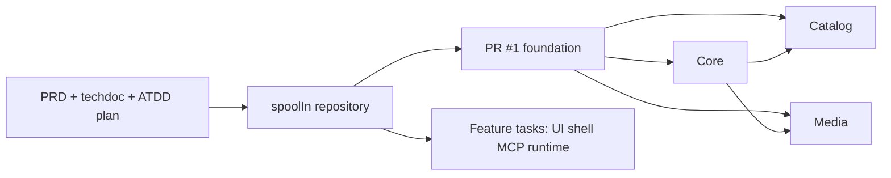

# SpoolIn

## What Was Built

[SpoolIn](https://github.com/okfriansyah-moh/spoolIn) is a public engineering project for a
**local movie and television catalog**. Visitors browse active titles; registered viewers manage
their own sessions; maintainers curate movies, people, credits, artwork, and audit history. The
product direction adds **exact-content MCP movie creation** — AI chat clients propose structured
movie records, but maintainers approve before anything publishes.

The repository opened on **2026-10-15** with product requirements (`docs/02-PRD.md`), a detailed
technical design (`docs/04-spoolin-techdoc.md`), acceptance-driven plans (`docs/05-atdd.md`,
`docs/06-PLAN.md`), and agent workflow bundles under `.ai/`. The first implementation slice —
reproducible builds, generated contracts, and private Core/Catalog/Media foundations — merged in
[PR #1](https://github.com/okfriansyah-moh/spoolIn/pull/1).

## The Problem

Personal media libraries scattered across spreadsheets, notes, and streaming bookmarks do not give
maintainers:

- A single **archive-first lifecycle** (archive, restore, delete with consequence review).
- **Role-separated access** (visitor vs viewer vs maintainer vs local operator).
- **Traceable catalog audits** when metadata or artwork changes.
- A safe path to **AI-assisted catalog expansion** without letting a model silently publish titles.

SpoolIn targets a self-hosted installation a solo operator can run on loopback with containers,
not a multi-tenant SaaS.

## Why This Problem Is Difficult

1. **Rich domain** — movies, television (read-only seed), people, credits, genres, roles, and
   artwork each carry different visibility rules.
2. **Cross-surface clients** — browser UI, MCP via Claude Desktop stdio bridge, and ChatGPT tunnel
   each need distinct credentials yet share Core gateways.
3. **Evidence-heavy delivery** — the plan tracks hundreds of acceptance cases; foundation tasks
   require reproducible builds and boundary tests before feature waves.
4. **Security posture** — mTLS between services, CSRF for GraphQL (planned), and scoped actor
   assertions for protected catalog writes.

## Beginner Mental Model

SpoolIn is a **curated home theater ledger**:

- The **ledger** (Catalog) records what exists and who acted in it.
- The **foyer** (Core) checks IDs and routes guests to the right room.
- The **poster wall** (Media) stores artwork and remembers which frame belongs to which title.
- **MCP** is a mail slot for structured movie proposals — staff still signs before they go on the wall.

## Requirements and Constraints

| Requirement | Where it lives |
| ----------- | -------------- |
| 100-movie / 100-TV starter snapshot | Techdoc §1 — frozen seed data |
| Television metadata read-only | Techdoc §1 |
| Maintainer-only mutations | Actor table techdoc §1.1 |
| Local operator responsibilities | Separate from Maintainer browser role |
| Portable agent workflow | `.ai/bundles/` — 1.1.1 (PR #2), 1.2.0 (PR #5), 1.2.1 + staged plan layout (PR #7) |
| Public standalone presentation | PR #3 documentation cleanup |
| Application shell + accounts | Merged [PR #4](https://github.com/okfriansyah-moh/spoolIn/pull/4) (shell) and [PR #6](https://github.com/okfriansyah-moh/spoolIn/pull/6) (sessions, policy, receipts, admission) |

## Architecture Summary

Deep dive: [SpoolIn system architecture](/docs/systems/spoolin-catalog-platform).

## Evolution and Milestones

| Date | Milestone |
| ---- | --------- |
| 2026-10-15 | Repository created; product and technical docs checked in |
| 2026-10-15 | [PR #1](https://github.com/okfriansyah-moh/spoolIn/pull/1) merged — T001–T003 foundation (contracts, services, databases, Compose) |
| 2026-10-15 | [PR #2](https://github.com/okfriansyah-moh/spoolIn/pull/2) merged — portable agent workflow 1.1.1 for unattended verification |
| 2026-10-15 | [PR #3](https://github.com/okfriansyah-moh/spoolIn/pull/3) merged — public standalone project presentation (docs) |
| 2026-10-16 | [PR #4](https://github.com/okfriansyah-moh/spoolIn/pull/4) merged — T004 themed accessible shell + T005 protected account storage |
| 2026-10-16 | [PR #5](https://github.com/okfriansyah-moh/spoolIn/pull/5) merged — portable agent workflow **1.2.0** (task delivery harness; 269 tests in PR evidence) |
| 2026-10-16 | [PR #6](https://github.com/okfriansyah-moh/spoolIn/pull/6) merged — T006–T010 account access wave (sessions, effective policy, receipts, scoped admission, browser journeys) |
| 2026-10-16 | [PR #7](https://github.com/okfriansyah-moh/spoolIn/pull/7) merged — plan folders renumbered into 26 dependency-ordered stages (workflow **1.2.1**); no API or ATDD ID changes |
| 2026-10-17 | [PR #8](https://github.com/okfriansyah-moh/spoolIn/pull/8) merged — G04–G16 catalog browse, drafts, maintainer writes, artwork, and archive UI (T006–T026 source closure; formal G26 accept pending) |
| 2026-10-18 | [PR #9](https://github.com/okfriansyah-moh/spoolIn/pull/9) merged — G17–G26 draft recovery, MCP proposals + review UI, seed/ops tooling, release handoff matrix (runtime acceptance still open) |
| 2026-10-18 | [PR #10](https://github.com/okfriansyah-moh/spoolIn/pull/10) merged — beginner install README, `local-*` Docker workflow, presentation refresh, History UUID fix, partial remote acceptance lane (still not full G26 accept) |
| 2026-10-18 | [PR #11](https://github.com/okfriansyah-moh/spoolIn/pull/11) merged — maintainer catalog/management UX (filters, search, credits navigation, artwork prep, save completion flows, `local-repair-accounts`) |
| 2026-10-18 | [PR #12](https://github.com/okfriansyah-moh/spoolIn/pull/12) merged — Maintainer README walkthrough + screenshots aligned to current UI (docs only) |
| 2026-10-19 | [PR #13](https://github.com/okfriansyah-moh/spoolIn/pull/13) merged — Svelte 5 reactive `*.svelte.ts` controllers for session/catalog/maintainer flows (UI unchanged; broader unit/DOM coverage) |
| 2026-10-21 | [PR #14](https://github.com/okfriansyah-moh/spoolIn/pull/14) merged — MCP **prepared posters** and **proposal credits**, combined **`movie_review_queue`** for in-chat review, matching Maintainer browser proposal pages with CSRF, Catalog migrations V023–V025, and 24-hour proposal expiry (automated test coverage not run per PR evidence) |
| Next | Close remaining G26 runtime gates (Playwright matrix, live MCP clients, delivery review), building on PR #10 partial lane evidence |

## Key Decisions

| Decision | Rationale |
| -------- | --------- |
| Kotlin/Spring Boot services | Typed enterprise stack with Flyway, gRPC, and future GraphQL |
| SvelteKit frontend | Merged shell and manage routes (PR #4, #8); static build served by Core |
| MCP gateway on Core | Central approval and policy enforcement for chat clients |
| Evidence-first task plan | ATDD + harness gates before claiming feature completeness |
| Local Compose deployment | Personal installation scope; no managed cloud requirement in v1 design |

## Relationship to Other Projects

SpoolIn shares **delivery discipline** with
[Delivery Foundry](/docs/projects/delivery-foundry) — Foundry governs venture-scale evidence
loops, while SpoolIn applies similar gate thinking to a focused catalog product. Contract
generation and reproducible builds echo patterns documented for
[deterministic AI pipelines](/docs/concepts/deterministic-ai-pipelines), but SpoolIn is an
independent codebase.

## Lessons Learned

1. **Ship foundation before UI polish** — contracts and database ownership de-risk later catalog
   and MCP tasks.
2. **Document actor types early** — separating Maintainer from local operator prevents permission
   shortcuts in implementation plans.
3. **Keep public narrative aligned with evidence** — PR #3 reframed docs without changing runtime
   behavior, preserving traceability for reviewers.
4. **Watch open coherence PRs elsewhere** — when [a2a-brainstormer#12](https://github.com/okfriansyah-moh/a2a-brainstormer/pull/12)
   merges, cross-link MCP approval patterns to [AI document coherence](/docs/concepts/ai-document-coherence).

## Related

- [SpoolIn system architecture](/docs/systems/spoolin-catalog-platform)
- [LLM guardrails](/docs/concepts/llm-guardrails)

## Sources

- Repository: [okfriansyah-moh/spoolIn](https://github.com/okfriansyah-moh/spoolIn)
- Pull requests: [#1](https://github.com/okfriansyah-moh/spoolIn/pull/1)–[#14](https://github.com/okfriansyah-moh/spoolIn/pull/14) (foundation through combined proposal review queue; G26 runtime accept still open)
- Technical design: `docs/04-spoolin-techdoc.md`
