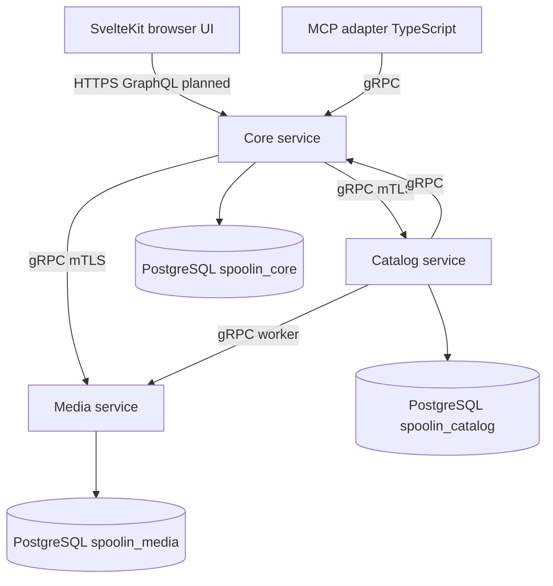

# SpoolIn: Multi-Service Catalog Platform Architecture

## What Was Built

[SpoolIn](https://github.com/okfriansyah-moh/spoolIn) is a local movie and television
discovery catalog with search, filters, cast and crew details, artwork management, audit
history, and **human-approved AI movie creation through MCP** (Model Context Protocol).
The public repository landed on **2026-10-15** with a full technical design specification
(`docs/04-spoolin-techdoc.md`) and an executable **reproducible foundation** delivered in
[merged PR #1](https://github.com/okfriansyah-moh/spoolIn/pull/1) (Tasks T001–T003).

That foundation pins toolchains, generates shared wire contracts, and boots three Kotlin/Spring
Boot services — **Core**, **Catalog**, and **Media** — each with its own PostgreSQL database,
TLS-verified JDBC URLs, private mTLS gRPC listeners, serialized Flyway migrations, and gRPC
health that stays `NOT_SERVING` until schema validation passes.

Later product features (browser GraphQL shell, catalog mutations, MCP adapter runtime) are
specified in the techdoc and tracked as implementation tasks; this article separates **what
merged PR #1 proves in code** from **what the design document targets next**.

## The Problem

A personal media catalog that supports maintainers, viewers, and MCP-assisted creation cannot
safely live in one monolithic database or one shared database role:

1. **Catalog integrity** — public visibility rules must hold even when Core is misconfigured.
2. **Artwork isolation** — binary media and reservations should not share SQL credentials with
   title metadata.
3. **Contract drift** — browser GraphQL, gRPC between services, JSON policy schemas, and MCP
   payloads must stay compatible across Kotlin and TypeScript consumers.
4. **Local operability** — a solo operator needs reproducible builds, one-command startup, and
   truthful readiness probes before exposing HTTPS on loopback.

## Why This Problem Is Difficult

1. **Three databases, zero cross-service SQL** — each service owns migrations and runtime
   pools; coordination happens only through typed RPCs.
2. **Security defaults** — PostgreSQL uses `sslmode=verify-full`, secrets are file-backed with
   mode `0600`, and gRPC methods map to explicit caller certificate identities.
3. **Migration safety** — only one migrator may hold the advisory lock; runtime pods refuse to
   serve if Flyway reports pending or out-of-range schema versions.
4. **Generated contracts** — GraphQL SDL, protobuf services, and JSON schemas must regenerate
   identically in CI and on developer machines (22 matching output pairs in PR evidence).
5. **Future MCP approval path** — exact-content movie proposals must not bypass Maintainer
   authorization; the design reserves `McpGatewayService` RPCs with MCP-only caller identities.

## Beginner Mental Model

Picture three specialized shops on one street:

- **Core** is the front desk — sessions, gateways, and (eventually) GraphQL for the browser.
- **Catalog** is the inventory ledger — titles, people, credits, audits; it never reaches into
  Media’s storage room directly.
- **Media** is the frame shop — artwork bytes and reservations; it confirms holds through RPCs,
  not shared tables.

A laminated **menu** (`contracts/graphql`, `contracts/grpc`, `contracts/json`) is photocopied
for every shop so nobody improvises message shapes at the door.

## Requirements and Constraints

| Requirement | Evidence in repository |
| ----------- | ------------------------ |
| Reproducible JVM/Node builds | Locked Gradle verification metadata, pinned images, T001 harness |
| Shared contracts | `contracts/graphql/schema.graphql`, `contracts/grpc/.../spoolin.proto`, JSON schemas |
| Service-owned databases | `spoolin_core`, `spoolin_catalog`, `spoolin_media` JDBC URLs in `ops/compose.yaml` |
| Least-privilege DB roles | Separate `runtime` vs `migrator` users per service (`DatabaseSettings` in Core) |
| Private mTLS transport | Service certs, `ServiceIdentityInterceptor`, SAN identities `core/catalog/media/mcp` |
| Truthful readiness | `SchemaReadiness` + gRPC `HealthStatusManager` until migrations validate |
| Local Compose deployment | `ops/compose.yaml` with read-only containers, dropped capabilities, loopback HTTPS |
| Operator-only metrics | Actuator routes require client cert identities (`ListenerBoundary`) |

## Architecture Overview

Target runtime (from techdoc §2) with **foundation services** implemented:



PR #1 delivers the three backend applications, contract generation pipeline, Postgres image,
and Compose wiring; GraphQL auto-configuration is explicitly excluded in Core’s
`@SpringBootApplication` until later tasks enable the browser API.

## Execution Flow

### 1. Contract generation (T002)

1. Engineers edit canonical sources under `contracts/`.
2. `build-tools/generate-*.mjs` emits Java, TypeScript, and verification fixtures.
3. Consumer tests prove strict typing boundaries (GraphQL probe, protobuf round-trips, JSON schema).

### 2. Image build and dependency lock (T001)

1. Gradle verification metadata pins dependency hashes.
2. Container images (`spoolin-*-foundation`) build from `ops/containers/*.Dockerfile`.
3. Harness tests assert two clean builds produce identical generated artifacts.

### 3. Database preparation and migration (T003)

1. Postgres container initializes per-service databases and roles from secret files.
2. `core-migrator` (Compose profile `migration`) runs `Application --migrate`.
3. `MigrationRunner` acquires `pg_advisory_lock(1936749166)`, runs Flyway on schema `appdata`,
   validates, then releases the lock.
4. Runtime `core` pod starts only when `SchemaReadiness` sees current version within
   configured min/max and no pending migrations.

### 4. Protected RPC dispatch (foundation)

1. gRPC server presents service certificate; peer certificate SAN maps to identity
   (`certificateIdentity`).
2. `ServiceIdentityInterceptor` allows only configured caller sets per method (for example
   Catalog may call `IdentityService/CheckActor`; MCP may call `McpGatewayService/*`).
3. Health checks accept identities `core`, `catalog`, `media`, `mcp`, or `operator`.

### 5. Catalog read/mutation sequence (design — techdoc §2.3)

Specified for upcoming feature tasks: browser mutation → Core → Catalog `CheckActor` → local
transaction → optional `GetOperation` reconciliation if the response is lost. Foundation code
registers stub gRPC services so wiring and identity rules can be tested before business logic
lands.

## Important Components

| Component | Responsibility |
| --------- | -------------- |
| `build-tools/generate-contracts.mjs` | Orchestrates GraphQL, protobuf, JSON, and token generation |
| `contracts/grpc/spoolin/v1/spoolin.proto` | gRPC API surface (Identity, Catalog, Media, MCP gateway) |
| `services/core` | Accounts gateway, MCP entrypoints (stubs), HTTPS static navigation fixture |
| `services/catalog` | Catalog domain service (foundation boundary tests) |
| `services/media` | Artwork service (foundation boundary tests) |
| `ops/compose.yaml` | Private network, secrets, migrator profiles, loopback port publish |
| `MigrationRunner` / `SchemaReadiness` | Serialized migrations and serving gate |
| `ServiceIdentityInterceptor` | mTLS identity to method allowlists |
| `docs/04-spoolin-techdoc.md` | Authoritative design for lifecycle, MCP approval, durable work |

## Simplified Implementation Examples

Simplified from `DatabaseSettings.validateUrl` — JDBC must target the owned database with
verified TLS:

```kotlin
require(url.startsWith("jdbc:postgresql://"))
require(uri.path == "/spoolin_$owner" && uri.userInfo == null)
require(parameters.any { it == listOf("sslmode", "verify-full") })
```

Simplified migration gate:

```kotlin
fun ready(): Boolean {
  val flyway = ownerFlyway(dataSource)
  val current = flyway.info().current() ?: return false
  return current.version in minimumVersion..maximumVersion &&
    flyway.info().pending().isEmpty() &&
    flyway.validateWithResult().validationSuccessful
}
```

## Reliability and Idempotency

- **Migrations** — advisory lock prevents concurrent migrators; Flyway `cleanDisabled(true)`
  blocks destructive resets in production paths.
- **Readiness** — gRPC health flips to `SERVING` only when schema validation succeeds;
  scheduled refresh re-checks every second.
- **Durable work (design)** — techdoc §7 defines database-persisted jobs for cross-service
  effects (for example artwork confirm) without distributed transactions; workers reconcile
  with `GetOperation` style receipts after timeouts.
- **Idempotent client ops (design)** — GraphQL mutations carry operation UUIDs so browsers can
  resubmit safely after network loss.

## Failure Modes

| Failure | Detection | Recovery |
| ------- | --------- | -------- |
| Pending migrations | `SchemaReadiness` down | Run migrator profile; never force runtime serve |
| Lock contention | Migration budget exceeded | Retry migrator; investigate stuck session |
| Wrong DB role | Startup `require` on username pattern | Fix Compose secrets / env |
| Unauthorized gRPC caller | `PERMISSION_DENIED` | Rotate certs; fix SAN mapping |
| Secret file permissions | `requireProtectedFile` throws | chmod `600`, single-line secret |
| Media unavailable during read (design) | Core degrades artwork URLs | Catalog metadata still returns |

## Trade-offs and Rejected Alternatives

| Decision | Rationale |
| -------- | --------- |
| Three databases vs one | Blast-radius isolation; aligns with per-service Flyway ownership |
| Generated contracts vs hand-written DTOs | Prevents GraphQL/protobuf drift across Kotlin and TypeScript |
| Excluding GraphQL auto-config initially | Lets foundation prove transport/security before exposing browser API |
| Stub gRPC services in PR #1 | Enables identity and health testing without unfinished catalog logic |
| Compose on loopback vs cloud K8s | Techdoc explicitly scopes personal local installation |

## Testing

PR #1 evidence (independent of this docs site):

- **T001** — 32/32 checks; two clean builds → 22 matching artifact pairs.
- **T002** — 22/22 contract tests including Java and strict TypeScript consumers.
- **T003** — 15 PostgreSQL/mTLS/HTTP boundary cases + 15 architecture rule cases; high changed-line
  coverage on Core/Catalog/Media modules.
- Integration tests under `services/*/src/integrationTest/.../OwnerBoundaryTest.kt` enforce
  foundation rules per service.

## Operations and Observability

- **Commands** — `Makefile` public commands (see techdoc §11) orchestrate start, test, and migration flows.
- **Compose** — set `SPOOLIN_INSTALLATION`; Core HTTPS defaults to `127.0.0.1:8443`.
- **Metrics** — Prometheus scrapes private Actuator endpoints; `ListenerBoundary` requires
  `prometheus` client cert on `/actuator/prometheus`.
- **Logs** — techdoc §12 specifies JSON log contracts for later operational hardening.

## Lessons Learned

1. **Prove transport and schema gates before features** — health that lies is worse than health
   that stays red until migrations finish.
2. **Treat contracts as compilable artifacts** — generation + consumer tests catch drift earlier
   than integration tests alone.
3. **Encode security invariants in startup `require` blocks** — JDBC URL shape and secret file
   modes fail fast instead of at 2 a.m.
4. **Keep MCP approval on Core’s gateway** — centralizing `McpGatewayService` preserves
   Maintainer authorization even when chat clients change.

## Related

- [SpoolIn project overview](/docs/projects/spoolin)
- [Database-backed state machines](/docs/concepts/database-state-machines)
- [LLM guardrails](/docs/concepts/llm-guardrails) — analogous approval boundaries for AI inputs

## Sources

- Repository: [okfriansyah-moh/spoolIn](https://github.com/okfriansyah-moh/spoolIn)
- Pull request: [#1 Implement reproducible build, contracts, and private service foundation](https://github.com/okfriansyah-moh/spoolIn/pull/1) (merge `83c40e9`)
- Design specification: `docs/04-spoolin-techdoc.md` (v1.11, October 2026)
- Evidence commit cited in PR #1: `12e487f001b66c2f3a5802654c6928849aa47c49`
