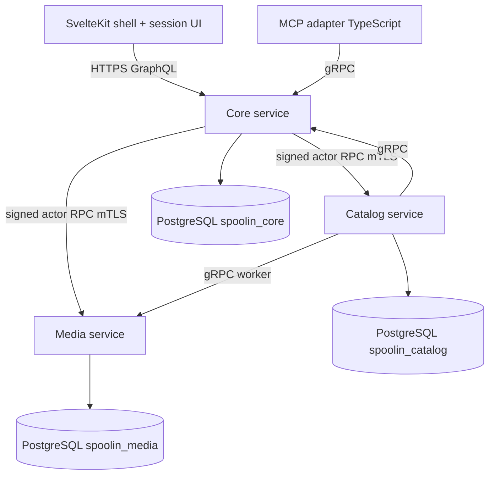

# SpoolIn: Multi-Service Catalog Platform Architecture

## What Was Built

[SpoolIn](https://github.com/okfriansyah-moh/spoolIn) is a local movie and television
discovery catalog with search, filters, cast and crew details, artwork management, audit
history, and **human-approved AI movie creation through MCP** (Model Context Protocol).
The public repository landed on **2026-10-15** with a full technical design specification
(`docs/04-spoolin-techdoc.md`) and an executable **reproducible foundation** delivered in
[merged PR #1](https://github.com/okfriansyah-moh/spoolIn/pull/1) (Tasks T001–T003).

That foundation pins toolchains, generates shared wire contracts, and boots three Kotlin/Spring
Boot services — **Core**, **Catalog**, and **Media** — each with its own PostgreSQL database,
TLS-verified JDBC URLs, private mTLS gRPC listeners, serialized Flyway migrations, and gRPC
health that stays `NOT_SERVING` until schema validation passes.

Follow-on merges extended the stack beyond the backend foundation:

- [PR #4](https://github.com/okfriansyah-moh/spoolIn/pull/4) (T004–T005) — shared **SvelteKit application shell** with themed, accessible navigation and **protected account storage** in Core (encrypted identities, Argon2 credential hashing, PostgreSQL integration tests).
- [PR #6](https://github.com/okfriansyah-moh/spoolIn/pull/6) (T006–T010, T007 scope) — **registration and authoritative sessions**, **effective input policy** semantics, **owner receipts** with atomic mutation evidence, **scoped service identity and shared admission** across Core/Catalog/Media, plus connected register/sign-in/sign-out browser journeys.
- [PR #8](https://github.com/okfriansyah-moh/spoolIn/pull/8) (T006–T026, G04–G16) — **public catalog reads and discovery UI**, **encrypted drafts** with browser controllers, **authoritative movie/person/credit writes** and maintainer editors, **artwork upload streams** with holds and attachment, plus **archive/restore lifecycle** and artwork progress UI (plan tasks marked *implementation complete*; formal selection accept deferred to G26).
- [PR #9](https://github.com/okfriansyah-moh/spoolIn/pull/9) (T027–T046, G17–G26) — **editor draft recovery** (`draft-sync`), **MCP streamable HTTP transport** and connector identity, **immutable movie proposals** with **exact-approval binding** (UI challenge only in MCP `_meta.ui`, not redeemable from model text), **trusted in-chat review resource**, read-only **audit UI**, **frozen 100+100 seed manifest** with replay CLI, **safe JSON diagnostics**, reproducible **lifecycle ops scripts**, and **release handoff** matrix (`docs/release/g01-g26-closure-matrix.md`). Independent review resolved required source findings; **runtime acceptance** (Playwright matrix, live MCP clients, Compose stacks) remains open per PR evidence.
- [PR #10](https://github.com/okfriansyah-moh/spoolIn/pull/10) — **beginner install README** (Windows/WSL2, macOS, Ubuntu), illustrated stakeholder guide, **`local-*` Make workflow** in Docker with preserved credentials/data, **presentation refresh** aligned to approved dark/light mockups, **GraphQL audit UUID string fix** (History no longer returns raw Java UUID objects), and **HTML fallback routing** for `/manage/` deep links. Includes a **partial remote acceptance lane** on GitHub-hosted Ubuntu (seed replay, MCP stdio→HTTP→mTLS path, monitoring assertions) that still failed one Playwright case and left broader delivery gates pending.
- [PR #11](https://github.com/okfriansyah-moh/spoolIn/pull/11) — **maintainer catalog UX hardening**: active-title-derived filters, stable catalog viewport during filter changes, management list search with pagination, **created-record return panels**, split **Cast and creators** navigation, unified **PersonSearchSelect**, client-side **artwork resize/prepare** with terminal dimension rejection, **list return scroll restoration** via validated session-storage tokens, **`make local-repair-accounts`**, and confirmed **Save movie / Save person** completion flows with server-reported field issues.
- [PR #12](https://github.com/okfriansyah-moh/spoolIn/pull/12) — **Maintainer README walkthrough** and screenshots refreshed to match merged UI (documentation-only in the application repository).
- [PR #13](https://github.com/okfriansyah-moh/spoolIn/pull/13) — **Svelte 5 reactive controller modules** for eight maintainer/session/catalog flows: controllers move to `*.svelte.ts` classes with `$state.raw` snapshots, routes bind through `$derived` instead of manual subscribe/copy loops, and lifecycle `dispose()` stays explicit. No Python, GraphQL, or visual design changes; PR evidence reports pixel-identical before/after screenshots and expanded unit/DOM coverage.
- [PR #14](https://github.com/okfriansyah-moh/spoolIn/pull/14) — **prepared movie posters**, **optional cast/crew credits on proposals**, and a **combined MCP/browser review queue** (`movie_review_queue`) where each pending movie shows its poster, exact-revision decision controls, and completion status. Credits join the **immutable proposal digest** (empty-credit proposals keep prior hashes); people and credits persist only on Maintainer approval inside the movie transaction. Browser maintainers review the same immutable payload under a signed-in session with **CSRF protection**. Catalog migrations **V023–V025** add poster preparation tables and credit columns; MCP JSON schemas expose queue shapes for tool discovery. Follow-up commits register **`ListMovieProposals`** with Catalog actor authentication and add bounded operator repair scripts for legacy saved movies (data repair lane, not automatic backfill).
- [PR #16](https://github.com/okfriansyah-moh/spoolIn/pull/16) — **repository hygiene without product redesign**: all four project prompts live under `docs/prompts/` (the legacy `docs/prompt/` tree removed), unused MCP review modules and Catalog seed helpers deleted after consumer checks, and **shared list-return state** consolidated into `frontend/src/lib/state/list-return.ts` for movie and person maintainer flows. SpoolIn pins **agent-workflow bundle 1.3.0** (including the shared [implementation-first reuse policy](https://github.com/okfriansyah-moh/agentic-workflow/blob/main/docs/DELIVERY.md#reuse-and-evidence-based-cleanup)) via the official updater; local skills link to that policy instead of copying cleanup rules. New `repository-hygiene.mjs` verification encodes prompt placement and local-link rules. PR evidence reports hygiene and four regression cases passing; full frontend static/type suites were **blocked by host memory pressure** at merge time.

This article separates **merged source evidence** from **runtime proof still pending** in the
G01–G26 closure matrix (including partial lanes from PR #10).

## The Problem

A personal media catalog that supports maintainers, viewers, and MCP-assisted creation cannot
safely live in one monolithic database or one shared database role:

1. **Catalog integrity** — public visibility rules must hold even when Core is misconfigured.
2. **Artwork isolation** — binary media and reservations should not share SQL credentials with
   title metadata.
3. **Contract drift** — browser GraphQL, gRPC between services, JSON policy schemas, and MCP
   payloads must stay compatible across Kotlin and TypeScript consumers.
4. **Local operability** — a solo operator needs reproducible builds, one-command startup, and
   truthful readiness probes before exposing HTTPS on loopback.

## Why This Problem Is Difficult

1. **Three databases, zero cross-service SQL** — each service owns migrations and runtime
   pools; coordination happens only through typed RPCs.
2. **Security defaults** — PostgreSQL uses `sslmode=verify-full`, secrets are file-backed with
   mode `0600`, and gRPC methods map to explicit caller certificate identities.
3. **Migration safety** — only one migrator may hold the advisory lock; runtime pods refuse to
   serve if Flyway reports pending or out-of-range schema versions.
4. **Generated contracts** — GraphQL SDL, protobuf services, and JSON schemas must regenerate
   identically in CI and on developer machines (22 matching output pairs in PR evidence).
5. **Future MCP approval path** — exact-content movie proposals must not bypass Maintainer
   authorization; the design reserves `McpGatewayService` RPCs with MCP-only caller identities.

## Beginner Mental Model

Picture three specialized shops on one street:

- **Core** is the front desk — sessions, gateways, and (eventually) GraphQL for the browser.
- **Catalog** is the inventory ledger — titles, people, credits, audits; it never reaches into
  Media’s storage room directly.
- **Media** is the frame shop — artwork bytes and reservations; it confirms holds through RPCs,
  not shared tables.

A laminated **menu** (`contracts/graphql`, `contracts/grpc`, `contracts/json`) is photocopied
for every shop so nobody improvises message shapes at the door.

## Requirements and Constraints

| Requirement | Evidence in repository |
| ----------- | ------------------------ |
| Reproducible JVM/Node builds | Locked Gradle verification metadata, pinned images, T001 harness |
| Shared contracts | `contracts/graphql/schema.graphql`, `contracts/grpc/.../spoolin.proto`, JSON schemas |
| Service-owned databases | `spoolin_core`, `spoolin_catalog`, `spoolin_media` JDBC URLs in `ops/compose.yaml` |
| Least-privilege DB roles | Separate `runtime` vs `migrator` users per service (`DatabaseSettings` in Core) |
| Private mTLS transport | Service certs, `ServiceIdentityInterceptor`, SAN identities `core/catalog/media/mcp` |
| Truthful readiness | `SchemaReadiness` + gRPC `HealthStatusManager` until migrations validate |
| Local Compose deployment | `ops/compose.yaml` with read-only containers, dropped capabilities, loopback HTTPS |
| Operator-only metrics | Actuator routes require client cert identities (`ListenerBoundary`) |

## Architecture Overview

Target runtime (from techdoc §2) with **foundation services** implemented:



PR #1 delivers the three backend applications, contract generation pipeline, Postgres image,
and Compose wiring. PR #4 adds the static frontend shell served through Core; PR #6 wires
session GraphQL operations, policy guidance components, and cross-service admission using the
shared `backend-support` identity library. PR #8 connects catalog browsing, maintainer write
paths, drafts, and artwork journeys end-to-end in source. PR #9 closes the MCP proposal →
review → gateway approve/reject path in code and adds operational seed/ops tooling — with
explicit gaps for host-supplied connector tokens and full client acceptance (T038–T039).

## Execution Flow

### 1. Contract generation (T002)

1. Engineers edit canonical sources under `contracts/`.
2. `build-tools/generate-*.mjs` emits Java, TypeScript, and verification fixtures.
3. Consumer tests prove strict typing boundaries (GraphQL probe, protobuf round-trips, JSON schema).

### 2. Image build and dependency lock (T001)

1. Gradle verification metadata pins dependency hashes.
2. Container images (`spoolin-*-foundation`) build from `ops/containers/*.Dockerfile`.
3. Harness tests assert two clean builds produce identical generated artifacts.

### 3. Database preparation and migration (T003)

1. Postgres container initializes per-service databases and roles from secret files.
2. `core-migrator` (Compose profile `migration`) runs `Application --migrate`.
3. `MigrationRunner` acquires `pg_advisory_lock(1936749166)`, runs Flyway on schema `appdata`,
   validates, then releases the lock.
4. Runtime `core` pod starts only when `SchemaReadiness` sees current version within
   configured min/max and no pending migrations.

### 4. Protected RPC dispatch (foundation)

1. gRPC server presents service certificate; peer certificate SAN maps to identity
   (`certificateIdentity`).
2. `ServiceIdentityInterceptor` allows only configured caller sets per method (for example
   Catalog may call `IdentityService/CheckActor`; MCP may call `McpGatewayService/*`).
3. Health checks accept identities `core`, `catalog`, `media`, `mcp`, or `operator`.

### 5. Accessible shell and theme (T004 — PR #4)

1. SvelteKit routes mount inside `AppShell` with skip links, brand header, and capability-aware navigation.
2. Theme preference persists in browser storage with system-color-scheme fallback.
3. Shared design-system components (`Field`, `ConfirmDialog`, `SessionBoundary`, etc.) enforce consistent focus and error summaries for later catalog forms.

### 6. Protected account persistence (T005 — PR #4)

1. Maintainer/viewer identities are stored in Core-owned tables with **encrypted payloads** and bounded Argon2 hashing for secrets.
2. Email lookup uniqueness and IDNA2008 normalization run before persistence.
3. Integration tests cover nonce rotation, crash-after-reservation recovery, and PostgreSQL-backed credential boundaries.

### 7. Sessions, policy, receipts, and admission (T006–T010 — PR #6)

1. Browser forms post GraphQL operations (`register`, `sign-in`, `sign-out`, `bootstrap`) through a typed transport layer with parsed outcomes and validation rules.
2. **Effective input policy** returns precise field-level guidance (`PolicyGuidance`) so clients show the same semantics Core enforces server-side.
3. **Owner receipts** tie catalog mutations to durable evidence in the same database transaction as domain writes (atomic mutation + audit/work).
4. `libraries/backend-support` signs **actor assertions**; Catalog and Media verify scoped permissions via shared admission rules before serving protected RPCs.
5. Session menu and manage routes connect the shell to live Core session state.

### 8. Catalog browse, drafts, and maintainer writes (T011–T026 — PR #8)

1. Public GraphQL reads (`titles`, `title`, `people`) proxy through Core to Catalog gRPC with visibility rules intact.
2. **Protected drafts** store encrypted maintainer work-in-progress; browser helpers isolate drafts per account.
3. **Movie, person, and credit writes** execute in Catalog with owner receipts; SvelteKit manage routes wire editors to managed GraphQL.
4. **Artwork** flows stream uploads to Media, coordinate holds/reservations, and surface progress in the shell.
5. **Archive/restore/delete** lifecycle RPCs pair with confirmation UI on manage routes.

### 9. Draft recovery in editors (T027 — PR #9)

1. `draft-sync.ts` modules reconcile local editor state with server drafts after interruption (movie, person, credit panels).
2. Unit tests (`draft-sync.test.ts`, editor controller tests) lock expected recovery shapes; full browser recovery proof is still listed *pending* in the closure matrix.

### 10. MCP propose → exact approval → review UI (T028–T030 — PR #9)

1. TypeScript MCP gateway exposes **streamable HTTP** transport stubs and connector bearer handling.
2. Catalog **`ProposalWrites`** persists immutable proposal rows; **`ExactApprovalBinding`** ties approve actions to a bound UI challenge.
3. `propose_movie` tool results **strip** `ui_binding_token` from structured model content; the challenge appears only under `_meta.ui` with `visibility: app` (re-review finding F-001).
4. Review frame (`mcp/src/review/*`) fetches challenges via binding token; Core adds `/gateway/approve_movie` and `/gateway/reject_movie` with connector bearer verification.
5. **Not yet proven in lane:** `MCP_UI_ASSERTION` signing, live gRPC forward from MCP to gateway, Claude Desktop / ChatGPT client harness runs.

### 11. Seed, audit, diagnostics, and lifecycle ops (T031–T037 — PR #9)

1. **Audit reads** expose read-only outcomes; `manage/audit` route consumes GraphQL `audit`.
2. **`data/seed/manifest.json`** freezes 100 movies + 100 series; `validate_manifest.py` validates counts in CI/lane checks.
3. **`CatalogSeedLoader`** and `ops/bin/seed.sh` support init/replay with receipt semantics (DB execution not run in authoring lane).
4. **`SafeJsonDiagnostics`** and log converters redact binding tokens from JSON logs.
5. **`ops/bin/`** scripts (`start`, `stop`, `backup`, `restore`, `rotate-keys`, `logs`, …) document reproducible lifecycle commands; `make start` fails closed without `SPOOLIN_LOCK_DIR`.

### 12. Install docs, presentation, and acceptance repairs (PR #10)

1. Root `README.md` adds platform install paths, synthetic screenshot walkthroughs, and `local-*` targets that build pinned toolchains inside Docker while keeping host dependency caches in volumes.
2. Frontend tokens/layouts align public catalog hero, poster grid, and management workspaces with approved mockups without changing GraphQL contracts.
3. Audit GraphQL resolver returns **string UUIDs** for `subjectId` and `operationId`; Core serves the SPA catch-all for HTML navigation under `/manage/` while record routes stay authoritative.
4. Remote lane evidence (Actions run on Ubuntu) replayed frozen seed counts, exercised real MCP connector paths, and reported a single browser failure (`Create movie` still enabled after save) plus Bubblewrap/proc mount limits — not a full G26 accept.

### 13. Maintainer workflows and catalog stability (PR #11)

1. **CatalogFilters** derive genre/year/month choices from active titles; shallow history updates avoid scroll jumps when results shrink.
2. **Movies / Manage people** list controllers add labeled search, Enter submission, case-insensitive partial matching, and `Load more` without stealing focus.
3. Movie create flows route through **Add cast and creators**; **CreditPanel** + **PersonSearchSelect** consolidate person pickers; custom roles sit behind optional **RoleCreator**.
4. **ArtworkUploadField** decodes with `createImageBitmap`, resizes within byte/dimension limits client-side, and maps terminal Media rejections to operator-visible reasons.
5. **list-return.ts** tokens in session storage restore draft search, loaded depth, and scroll after credits or save journeys; failures fall back to ordinary navigation.
6. **`make local-repair-accounts`** re-hashes Viewer/Maintainer passwords from the prepared manifest in one transaction while revoking sessions (startup still preserves passwords).

### 14. Maintainer documentation refresh (PR #12)

1. Source-repo `README.md` updates Maintainer steps (artwork placement, credits page, searchable person control) and replaces PNG walkthrough assets — no Kotlin/TypeScript behavior changes.

### 15. Svelte 5 reactive controllers (PR #13)

1. Eight browser controllers rename to `*.svelte.ts` modules (session, draft, catalog browse, movie list/editor, person list/editor, artwork upload) so **reactive state lives inside the controller class** via `$state.raw`, exposing a read-only `snapshot` getter.
2. Svelte routes and feature components **derive UI state** with `$derived(controller?.snapshot ?? INITIAL_…)` instead of maintaining parallel `$state` copies fed by `subscribe` listeners.
3. Completion hooks (`onSaved`, `onCredentialReset`) replace some unsubscribe paths; `onMount` still constructs controllers and calls `dispose()` on teardown so in-flight GraphQL abort controllers stay bounded.
4. Small extractions (`uploadMessage`, `preparationError`, `list-return` helpers) clear frontend type/lint blockers; ESLint treats `**/*.svelte.ts` like Svelte sources. Transport contracts, persisted data, and rendered layouts remain unchanged per PR blast-radius notes.

### 16. Posters, proposal credits, and combined review (PR #14)

1. **`prepare_movie_poster`** (MCP) stores artwork candidates; **`propose_movie`** attaches metadata, optional credits, and a prepared poster reference before enqueueing review.
2. Catalog **`PreparedMoviePosters`** and **`ProposalCredits`** extend draft/proposal rows; Flyway **V023–V025** migrate poster and credit columns while keeping additive rollback constraints documented in the PR merge-danger note.
3. **`ProposalContent`** digest hashing includes normalized credits; proposals with **no credits** preserve hashes compatible with earlier revisions so stale approvals cannot bind to altered payloads.
4. MCP **`movie_review_queue`** returns owned, persisted proposals together — each entry carries poster preview, per-movie exact-approval controls, and private completion metadata; queue output schemas are embedded for MCP tool discovery.
5. In-chat review (`mcp/src/review/*`) and browser **`/manage/proposals/[id]`** render the same immutable proposal body; browser actions use Maintainer session cookies plus CSRF tokens on review mutations.
6. On approval, Catalog writes **people and credits inside the movie transaction**, then completes retry-safe poster attachment on the persisted operation; expired proposals honor the **24-hour TTL** introduced in this wave.
7. **`ListMovieProposals`** registers on Catalog gRPC with the same actor authentication pattern as other protected proposal RPCs (follow-up `65f594ec`).

## Important Components

| Component | Responsibility |
| --------- | -------------- |
| `build-tools/generate-contracts.mjs` | Orchestrates GraphQL, protobuf, JSON, and token generation |
| `contracts/grpc/spoolin/v1/spoolin.proto` | gRPC API surface (Identity, Catalog, Media, MCP gateway) |
| `frontend/src/lib/components/AppShell.svelte` | Accessible shell, theme, capability-aware nav (T004) |
| `services/core/.../ProtectedAccounts.kt` | Encrypted account identities and credential storage (T005) |
| `services/core` | GraphQL session gateway, MCP entrypoints, static frontend hosting |
| `frontend/src/lib/features/session/*` | Registration, sign-in, sign-out controllers and GraphQL documents (T006–T007) |
| `frontend/src/lib/policy/*` | Effective policy parsing and UI guidance (T009) |
| `libraries/backend-support` | Actor signing, trust files, scoped permissions, admission helpers (T008) |
| `services/catalog` | Catalog domain service with shared admission enforcement |
| `services/media` | Artwork service with shared admission enforcement |
| `ops/compose.yaml` | Private network, secrets, migrator profiles, loopback port publish |
| `MigrationRunner` / `SchemaReadiness` | Serialized migrations and serving gate |
| `ServiceIdentityInterceptor` | mTLS identity to method allowlists |
| `frontend/src/lib/features/catalog/*` | Discovery UI and public catalog reads (T012–T013) |
| `frontend/src/lib/features/*/draft-sync.ts` | Editor draft recovery after interruption (T027) |
| `services/catalog/.../ProposalWrites.kt` | Immutable MCP movie proposals and exact-approval binding (T029) |
| `mcp/src/review/*` | Trusted in-chat review resource (T030) |
| `build-tools/validate-seed/*` | Frozen seed manifest generation and validation (T032) |
| `ops/bin/*.sh` | Lifecycle operator commands (T037) |
| `docs/release/g01-g26-closure-matrix.md` | Per-task source vs runtime closure status (T046) |
| `docs/04-spoolin-techdoc.md` | Authoritative design for lifecycle, MCP approval, durable work |
| `frontend/src/lib/components/CatalogFilters.svelte` | Active-title filter choices and stable catalog navigation (PR #11) |
| `frontend/src/lib/features/credit/PersonSearchSelect.svelte` | Unified searchable person picker for credits (PR #11) |
| `frontend/src/lib/features/movie/list-return.ts` | Session-storage return tokens for list scroll/search restore (PR #11) |
| `frontend/src/lib/features/artwork/prepare-file.ts` | Client resize/decode before artwork upload (PR #11) |
| `Makefile` (`local-repair-accounts`) | Operator password repair bound to prepared manifest (PR #11) |
| `frontend/src/lib/features/*/*.svelte.ts` | Svelte 5 reactive controller modules with `snapshot` + `dispose()` (PR #13) |
| `mcp/src/tools/poster-import.ts` / `poster-output.ts` | MCP poster preparation and structured poster fields on tool results (PR #14) |
| `services/catalog/.../PreparedMoviePosters.kt` | Stores prepared artwork handles before proposal approval (PR #14) |
| `services/catalog/.../ProposalCredits.kt` | Normalized cast/crew rows bound to immutable proposals (PR #14) |
| `mcp/src/review/presentation.ts` | Combined queue layout with per-movie decision chrome (PR #14) |
| `frontend/src/lib/features/proposal/api.ts` | Maintainer GraphQL client for browser proposal review (PR #14) |
| `frontend/src/routes/manage/proposals/[id]/+page.svelte` | Signed-in proposal review UI with CSRF-aware actions (PR #14) |
| `contracts/json/mcp-outputs.schema.json` | `movie_review_queue` schema definitions for MCP discovery (PR #14) |

## Simplified Implementation Examples

Simplified from `DatabaseSettings.validateUrl` — JDBC must target the owned database with
verified TLS:

```kotlin
require(url.startsWith("jdbc:postgresql://"))
require(uri.path == "/spoolin_$owner" && uri.userInfo == null)
require(parameters.any { it == listOf("sslmode", "verify-full") })
```

Simplified migration gate:

```kotlin
fun ready(): Boolean {
  val flyway = ownerFlyway(dataSource)
  val current = flyway.info().current() ?: return false
  return current.version in minimumVersion..maximumVersion &&
    flyway.info().pending().isEmpty() &&
    flyway.validateWithResult().validationSuccessful
}
```

Simplified Svelte 5 controller binding (from `ArtworkUploadField.svelte` after PR #13):

```typescript
// controller.svelte.ts — reactive snapshot inside the class
export class ArtworkUploadController {
  private view = $state.raw(INITIAL_ARTWORK_UPLOAD_VIEW);
  get snapshot() {
    return this.view;
  }
}

// component — derive instead of subscribe + copy
const view = $derived(controller?.snapshot ?? INITIAL_ARTWORK_UPLOAD_VIEW);
```

## Reliability and Idempotency

- **Migrations** — advisory lock prevents concurrent migrators; Flyway `cleanDisabled(true)`
  blocks destructive resets in production paths.
- **Readiness** — gRPC health flips to `SERVING` only when schema validation succeeds;
  scheduled refresh re-checks every second.
- **Durable work (design)** — techdoc §7 defines database-persisted jobs for cross-service
  effects (for example artwork confirm) without distributed transactions; workers reconcile
  with `GetOperation` style receipts after timeouts.
- **Idempotent client ops (design)** — GraphQL mutations carry operation UUIDs so browsers can
  resubmit safely after network loss.
- **Proposal credits (PR #14)** — credits affect the immutable digest only while pending; approved
  people/credit rows commit atomically with the movie so partial publication cannot leave orphan
  cast records.
- **Poster attachment (PR #14)** — prepared poster handles reconcile through the persisted operation
  receipt path so retries after approval do not create duplicate artwork links.

## Failure Modes

| Failure | Detection | Recovery |
| ------- | --------- | -------- |
| Pending migrations | `SchemaReadiness` down | Run migrator profile; never force runtime serve |
| Lock contention | Migration budget exceeded | Retry migrator; investigate stuck session |
| Wrong DB role | Startup `require` on username pattern | Fix Compose secrets / env |
| Unauthorized gRPC caller | `PERMISSION_DENIED` | Rotate certs; fix SAN mapping |
| Secret file permissions | `requireProtectedFile` throws | chmod `600`, single-line secret |
| Media unavailable during read (design) | Core degrades artwork URLs | Catalog metadata still returns |
| Poster prep fails before propose (PR #14) | MCP tool returns structured failure | Operator fixes artwork source; proposal not enqueued |
| Expired proposal (PR #14) | TTL elapsed on queue row | Maintainer must re-propose; digest prevents silent reuse |
| Credit digest mismatch (PR #14) | Exact-approval binding rejects stale UI | Re-open queue entry; no publish on hash drift |

## Trade-offs and Rejected Alternatives

| Decision | Rationale |
| -------- | --------- |
| Three databases vs one | Blast-radius isolation; aligns with per-service Flyway ownership |
| Generated contracts vs hand-written DTOs | Prevents GraphQL/protobuf drift across Kotlin and TypeScript |
| Excluding GraphQL auto-config initially | Lets foundation prove transport/security before exposing browser API |
| Stub gRPC services in PR #1 | Enables identity and health testing without unfinished catalog logic |
| Compose on loopback vs cloud K8s | Techdoc explicitly scopes personal local installation |

## Testing

Repository evidence (independent of this docs site):

- **T001 (PR #1)** — 32/32 checks; two clean builds → 22 matching artifact pairs.
- **T002 (PR #1)** — 22/22 contract tests including Java and strict TypeScript consumers.
- **T003 (PR #1)** — 15 PostgreSQL/mTLS/HTTP boundary cases + 15 architecture rule cases.
- **T004–T005 (PR #4)** — 93 selected frontend unit/component tests, 32 browser shell cases,
  17 unit + 25 PostgreSQL account protection tests (per PR evidence table).
- **T006–T010 (PR #6)** — 32 shell, 40 policy, and 23 account browser cases reported passing;
  Semgrep/Gitleaks/OSV scans configured in the verification map (see PR #6 body for gate
  history during the long-running delivery run).
- **T006–T026 (PR #8)** — plan docs mark tasks *implementation complete*; PR author deferred full
  Playwright/browser matrix locally (host resource limits) — re-run on CI or remote host per PR #8 body.
- **T027–T046 (PR #9)** — unit tests for proposals, review state, draft-sync, audit API, seed
  validator, and MCP UI meta; `mcp tsc --noEmit` and `validate_manifest.py` pass in lane; Gradle IT,
  Compose, and client harness runs explicitly skipped until runtime acceptance.
- **PR #10** — macOS Docker verification (browse, edits, artwork, restart persistence); `make local-test`
  reported 42 helper checks, 387 frontend tests, 76 MCP tests, and Gradle tests passing; partial remote
  lane exercised seed/MCP/monitoring with one Playwright failure and skipped broader delivery gates.
- **PR #11** — large frontend/controller diff; PR evidence cites passing unit suites and manual macOS
  walkthrough of catalog filters, management search, credits navigation, and artwork preparation (no new
  public schema changes).
- **PR #12** — documentation wording check only; screenshots refreshed against merged UI.
- **PR #13** — 157 focused unit/DOM tests across 24 files plus eight browser smoke cases with
  controlled GraphQL fixtures; types, lint, build, and dependency scans pass in PR evidence;
  six representative before/after screenshots reported pixel-identical.
- **PR #14** — PR author reports **no automated test, lint, or typecheck suites executed** for
  this merge; evidence relies on independent source review, local Catalog migration V025, Docker
  image rebuilds, and manual MCP/browser verification on seven pending proposals. Treat runtime
  coverage as **unverified** against the repository’s 80% changed-line target.
- Integration tests under `services/*/src/integrationTest/...` enforce per-service foundation
  and crypto/account boundaries.

## Operations and Observability

- **Commands** — `Makefile` routes `start` to `ops/bin/start.sh`; lifecycle scripts under `ops/bin/`
  cover backup, restore, seed, key rotation, logs, and connector helpers (PR #9).
- **Compose** — set `SPOOLIN_INSTALLATION`; Core HTTPS defaults to `127.0.0.1:8443`.
- **Metrics** — Prometheus scrapes private Actuator endpoints; `ListenerBoundary` requires
  `prometheus` client cert on `/actuator/prometheus`.
- **Logs** — techdoc §12 specifies JSON log contracts for later operational hardening.

## Lessons Learned

1. **Prove transport and schema gates before features** — health that lies is worse than health
   that stays red until migrations finish.
2. **Treat contracts as compilable artifacts** — generation + consumer tests catch drift earlier
   than integration tests alone.
3. **Encode security invariants in startup `require` blocks** — JDBC URL shape and secret file
   modes fail fast instead of at 2 a.m.
4. **Keep MCP approval on Core’s gateway** — centralizing `McpGatewayService` preserves
   Maintainer authorization even when chat clients change.
5. **Never put redeemable approval secrets in model-visible structured content** — PR #9 review
   required stripping binding tokens from tool results and serving UI challenges only via MCP app metadata.
6. **Let controllers own reactive state in Svelte 5** — PR #13 shows that `$derived` snapshots beat
   hand-rolled listener sets when you need identical UI with clearer lifecycle boundaries.
7. **Fold credits into the proposal digest early** — PR #14 keeps empty-credit proposals hash-stable
   while still letting maintainers review cast/crew before anything hits the public catalog.
8. **One queue for chat and browser** — sharing `movie_review_queue` shapes between MCP tools and
   Maintainer UI avoids divergent approval stories for the same immutable payload.
9. **Centralize cross-feature UI state before duplicating helpers** — PR #16 shows list-return
   scroll restoration belongs in one module with feature-specific thin wrappers.
10. **Link shared agent policy, do not fork it** — bundle 1.3.0 carries `DELIVERY.md` reuse rules;
    SpoolIn-specific text stays limited to prompt paths and hygiene checks.

## Related

- [SpoolIn project overview](/docs/projects/spoolin)
- [Database-backed state machines](/docs/concepts/database-state-machines)
- [LLM guardrails](/docs/concepts/llm-guardrails) — analogous approval boundaries for AI inputs
- [Implementation-first reuse and cleanup](/docs/concepts/implementation-first-reuse-and-cleanup) —
  shared agent-workflow policy adopted in PR #16

## Sources

- Repository: [okfriansyah-moh/spoolIn](https://github.com/okfriansyah-moh/spoolIn)
- Pull requests:
  - [#1 Implement reproducible build, contracts, and private service foundation](https://github.com/okfriansyah-moh/spoolIn/pull/1) (merge `83c40e9`)
  - [#4 Add accessible shell and protected account storage](https://github.com/okfriansyah-moh/spoolIn/pull/4) (merge `1d0f96b`)
  - [#6 Implement account access, effective policy, receipts and scoped admission](https://github.com/okfriansyah-moh/spoolIn/pull/6) (merge `ffcaae5`)
  - [#8 G04–G16: policy through artwork journeys](https://github.com/okfriansyah-moh/spoolIn/pull/8) (merge `053eb8a`)
  - [#9 G17–G26: draft recovery through release handoff](https://github.com/okfriansyah-moh/spoolIn/pull/9) (merge `2764ca8`)
  - [#10 Remote acceptance lane + install/README refresh](https://github.com/okfriansyah-moh/spoolIn/pull/10) (merge `71430bd`)
  - [#11 Catalog management and saved-record workflows](https://github.com/okfriansyah-moh/spoolIn/pull/11) (merge `929bfdb`)
  - [#12 Maintainer walkthrough screenshots](https://github.com/okfriansyah-moh/spoolIn/pull/12) (merge `0b5348b`)
  - [#13 Svelte 5 reactive controllers](https://github.com/okfriansyah-moh/spoolIn/pull/13) (merge `d4b21d1`)
  - [#14 MCP posters, credits, and combined proposal review](https://github.com/okfriansyah-moh/spoolIn/pull/14) (merge `6470702`)
  - [#16 Consolidate prompts and remove unused SpoolIn code](https://github.com/okfriansyah-moh/spoolIn/pull/16) (merge `5498f51`)
- Design specification: `docs/04-spoolin-techdoc.md` (v1.11, October 2026)
- Evidence commit cited in PR #1: `12e487f001b66c2f3a5802654c6928849aa47c49`
