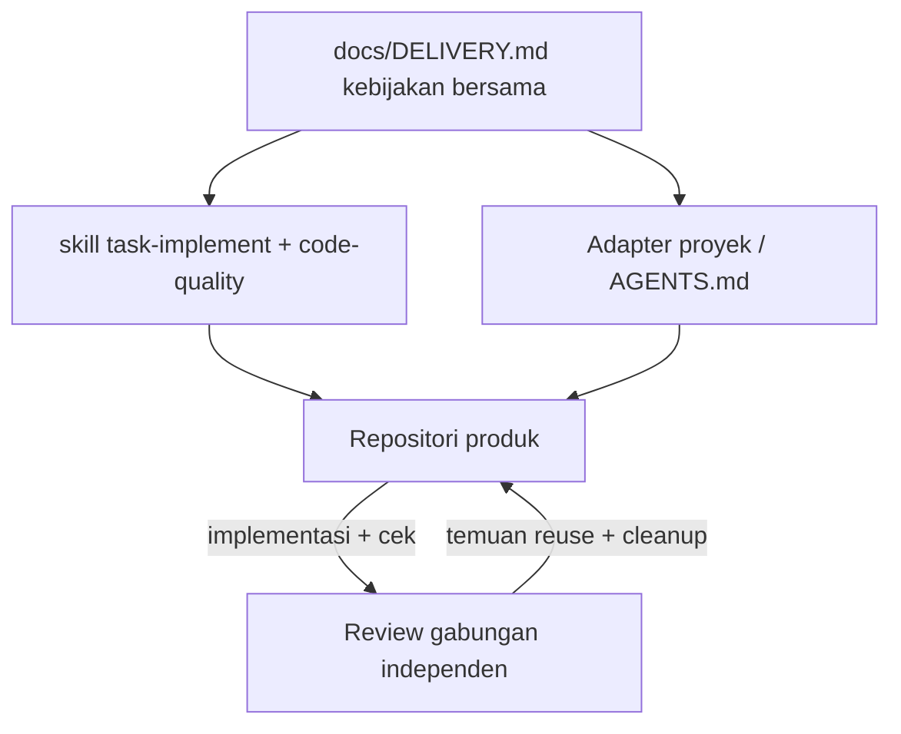

# Reuse Berbasis Implementasi dan Pembersihan Berbasis Bukti

## Apa yang Dibangun

Repositori publik [agentic-workflow](https://github.com/okfriansyah-moh/agentic-workflow)
menyediakan satu kebijakan delivery di `docs/DELIVERY.md` yang berlaku untuk Codex, Cursor AI,
Claude Code, dan GitHub Copilot. [PR #1 yang digabung](https://github.com/okfriansyah-moh/agentic-workflow/pull/1)
(2026-10-23) menambahkan bagian **Reuse and evidence-based cleanup** dan menghubungkannya ke skill
`task-implement` dan `code-quality`, adapter proyek, serta manifest bundle sehingga implementasi
dan review memakai aturan yang sama, bukan salinan per proyek.

Produk turunan (misalnya [SpoolIn PR #16](https://github.com/okfriansyah-moh/spoolIn/pull/16))
mem-pin bundle **1.3.0** dan menautkan prompt lokal ke kebijakan bersama alih-alih menduplikasi
panduan pembersihan di setiap repositori.

## Masalah

Repositori berbantuan agent menumpuk helper duplikat, direktori prompt paralel, dan commit
“pembersihan” yang menghapus kode yang masih dibutuhkan operator. Tanpa kebijakan bersama:

1. **Implementer menambah sebelum mencari** — file baru muncul di samping pemilik yang sudah ada.
2. **Dokumentasi melenceng** — aturan yang sama disalin ke skill, prompt, dan fragmen README.
3. **Penghapusan adalah tebakan** — referensi teks yang hilang atau hash yang cocok dianggap bukti
   modul tidak terpakai.
4. **Reviewer tidak selaras** — skill implementasi dan kualitas mengutip standar pembersihan berbeda.

## Mengapa Masalah Ini Sulit

1. **Batas berbeda per lapisan** — state list-return frontend, guard review MCP, dan kelas seed
   Catalog masing-masing punya kepemilikan layanan yang valid; deduplikasi sembarangan dapat
   merusak transaksi atau kontrak publik.
2. **Penemuan framework** — komponen Spring, rute SvelteKit, dan kontrak yang dihasilkan tidak
   selalu terjangkau hanya lewat graf impor statis.
3. **Insentif model** — model lebih suka file “bersih” karena lebih mudah diproses dalam satu giliran.
4. **Bundle lintas repo** — salinan `.ai/bundles/` yang di-pin harus tetap selaras digest-nya saat
   kebijakan upstream berubah.

## Model Mental untuk Pemula

Anggap repositori seperti perpustakaan dengan **katalog kartu** (`DELIVERY.md`):

- Sebelum menulis bab baru, **cari di rak** apakah sudah ada buku tentang topik itu.
- Jika topik sudah punya buku, **tambahkan catatan kaki** alih-alih memfotokopi bab ke binder lain.
- Sebelum membuang buku, **periksa siapa yang masih meminjam** (impor, tes, skrip ops, konfigurasi),
  bukan hanya apakah catatan Anda lupa menyebutkannya.

## Persyaratan dan Kendala

| Persyaratan | Sumber kebijakan |
| ----------- | ---------------- |
| Cari sebelum menambah | Perluas atau reuse jika perilaku dan tanggung jawab cocok |
| Satu pemilik per topik terdokumentasi | Tautkan dari prompt/skill; jangan salin aturan |
| Penghapusan terbatas | Hanya dalam seleksi yang disetujui; jaga kontrak dan fixture |
| Bukti konsumen | Impor, tes, generasi, titik masuk ops, persyaratan — bukan tebakan hash saja |
| Keselarasan review | Reviewer gabungan memeriksa batas reuse dan konsumen penghapusan |
| Tanpa mandat path global | Direktori proyek tetap konvensi proyek |

## Gambaran Arsitektur



## Alur Eksekusi

1. Koordinator memuat hasil yang disetujui dan hanya panduan yang dibutuhkan untuk pekerjaan terpilih.
2. Sebelum menambah file, fungsi, dependensi, atau dokumen, implementer mencari pemilik yang ada di
   **proyek saat ini**.
3. Aturan bisnis berulang dibagikan di dalam batas yang benar (misalnya modul bersama
   `frontend/src/lib/state/list-return.ts` untuk alur movie dan person).
4. Topik terdokumentasi mempertahankan **satu sumber pemilik**; artefak lain menautkannya.
5. Penghapusan terjadi hanya setelah pemeriksaan konsumen pada impor, wiring framework, tes, dan
   skrip ops; kandidat tidak pasti tetap di ledger temuan.
6. Reviewer gabungan memvalidasi batas reuse, konsumen penghapusan, dan perilaku terdampak setelah
   cek yang disepakati dijalankan.

## Komponen Penting

| Komponen | Tanggung jawab |
| -------- | --------------- |
| `docs/DELIVERY.md` | Aturan reuse dan cleanup kanonik |
| `skills/task-implement/SKILL.md` | Mengarahkan implementer ke kebijakan bersama |
| `skills/code-quality/SKILL.md` | Mengarahkan reviewer ke kebijakan yang sama |
| `adapters/AGENTS.md` | Menyalurkan agent proyek melalui teks delivery bersama |
| `manifest.json` | Digest skill tetap selaras saat bagian kebijakan berubah |
| `.ai/bundles/<version>/` proyek | Salinan ter-pin yang dikonsumsi repo produk (mis. SpoolIn 1.3.0) |

## Contoh Implementasi yang Disederhanakan

```markdown
<!-- Utamakan tautan daripada salinan di prompt proyek -->
Sebelum menambah helper list-return baru, perluas `frontend/src/lib/state/list-return.ts`
dan ikuti [aturan reuse DELIVERY.md](https://github.com/okfriansyah-moh/agentic-workflow/blob/main/docs/DELIVERY.md#reuse-and-evidence-based-cleanup).
```

```typescript
// disederhanakan — pola modul bersama (SpoolIn PR #16)
// movie/list-return.ts dan person/write/list-return.ts mengimpor dari lib/state/list-return.ts
import { createListReturnStore } from '$lib/state/list-return';
```

## Reliabilitas dan Idempotensi

Perubahan kebijakan adalah **dokumentasi dan wiring skill** — tidak mengubah layanan runtime.
Pin bundle diperbarui lewat updater resmi agar digest `manifest.json` dan tautan discovery tetap
konsisten setelah instal ulang. Override skill pribadi dan pin proyek yang ada tetap sampai operator
secara eksplisit memperbarui (sesuai bukti PR #1).

## Mode Kegagalan

| Kegagalan | Deteksi | Pemulihan |
| --------- | ------- | --------- |
| Direktori prompt duplikat | Cek hygiene repositori (SpoolIn `repository-hygiene.mjs`) | Gabungkan path dan perbarui referensi bersamaan |
| Penghapusan terlalu agresif | Tes gagal atau titik masuk ops hilang | Pulihkan dari Git; catat bukti di ledger temuan |
| Drift kebijakan antar repo | Digest bundle usang vs `DELIVERY.md` upstream | Jalankan update bundle; tautkan alih-alih menyalin |
| Review tanpa cek konsumen | Reviewer menerima alasan penghapusan hash saja | Tolak; minta bukti impor/tes/ops |

## Trade-off dan Alternatif yang Ditolak

| Pilihan | Alasan |
| ------- | ------ |
| Kebijakan pusat vs esai per repo | `DELIVERY.md` pusat skala ke banyak host; salinan lokal cepat basi |
| Tautan vs salinan di skill | Tautan menjaga satu permukaan edit; menyalin adalah mode gagal pra-PR #1 |
| Tanpa mandat direktori global | SpoolIn memakai `docs/prompts/`; repo lain bisa berbeda — kebijakan mengatur perilaku, bukan path |
| Ditolak: larangan duplikat file blanket | Kebijakan secara eksplisit menghindari framework audit tambahan; pakai lint/hygiene yang ada |

## Pengujian

Bukti PR #1 melaporkan empat tes paket skill (discovery/digest, tautan aktif, relokasi helper, cek
kontras pendukung), cek wording/whitespace, instal/update/doctor global terisolasi, dan update global
nyata dengan output doctor sehat. SpoolIn PR #16 menambahkan `repository-hygiene.mjs` dengan kasus
regresi untuk penempatan prompt dan aturan tautan lokal.

## Operasi dan Observabilitas

Operator memasang atau memperbarui bundle workflow lewat CLI yang didokumentasikan (`doctor`
melaporkan konflik). Proyek mencatat versi ter-pin di `.ai/config.json` dan `.ai/install-state.json`.
Saat perubahan kebijakan masuk upstream, naikkan pin bundle dan jalankan doctor ulang sebelum
mengklaim delivery.

## Pelajaran yang Dipetik

1. **Implementasi mengalahkan refactor kebersihan** — pembersihan diperbolehkan, tetapi bukan
   pengganti hasil yang disetujui.
2. **Penghapusan butuh konsumen, bukan firasat** — kecocokan hash dan tidak adanya teks tidak cukup.
3. **Skill harus mengutip kebijakan, bukan parafrasa** — menjaga implementer dan reviewer selaras.
4. **Cek hygiene mengodekan kesalahan berulang** — aturan penempatan prompt masuk tes otomatis setelah
   rusak dua kali.

## Terkait

- [Orchestrator agentik deterministik](/docs/concepts/deterministic-agentic-orchestrator) — loop tugas
  dengan checkpoint di skeleton-parallel
- [Ringkasan proyek SpoolIn](/docs/projects/spoolin) — mem-pin workflow 1.3.0 dan menerapkan hygiene
  setelah PR #16
- [LLM guardrails](/docs/concepts/llm-guardrails) — pola validasi output yang melengkapi

## Sumber

- Repositori: [okfriansyah-moh/agentic-workflow](https://github.com/okfriansyah-moh/agentic-workflow)
- Pull request: [#1 Share implementation-first reuse and cleanup guidance](https://github.com/okfriansyah-moh/agentic-workflow/pull/1) (merge `da9ca07`)
- File kebijakan: `docs/DELIVERY.md` (bagian Reuse and evidence-based cleanup)
- Contoh adopsi: [okfriansyah-moh/spoolIn#16](https://github.com/okfriansyah-moh/spoolIn/pull/16) (pin bundle 1.3.0)
