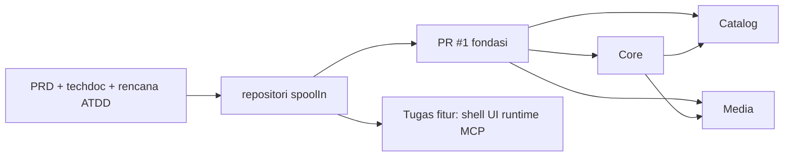

# SpoolIn

## Apa yang Dibangun

[SpoolIn](https://github.com/okfriansyah-moh/spoolIn) adalah proyek rekayasa publik untuk
**katalog film dan televisi lokal**. Pengunjung menelusuri judul aktif; viewer terdaftar mengelola
sesi sendiri; maintainer mengurus film, orang, kredit, artwork, dan riwayat audit. Arah produk
menambahkan **pembuatan film MCP exact-content** — klien chat AI mengusulkan catatan terstruktur,
tetapi maintainer menyetujui sebelum publikasi.

Repositori dibuka pada **2026-10-15** dengan persyaratan produk (`docs/02-PRD.md`), desain teknis
(`docs/04-spoolin-techdoc.md`), rencana berbasis ATDD (`docs/05-atdd.md`, `docs/06-PLAN.md`), dan
bundel alur agen di `.ai/`. Irisan implementasi pertama — build yang dapat direproduksi, kontrak
yang dihasilkan, dan fondasi Core/Catalog/Media privat — digabung dalam
[PR #1](https://github.com/okfriansyah-moh/spoolIn/pull/1).

## Masalah

Perpustakaan media pribadi yang tersebar di spreadsheet dan catatan tidak memberi maintainer:

- **Siklus hidup archive-first** tunggal (arsip, pulihkan, hapus dengan tinjauan konsekuensi).
- **Akses terpisah per peran** (pengunjung vs viewer vs maintainer vs operator lokal).
- **Audit katalog yang dapat dilacak** saat metadata atau artwork berubah.
- Jalur aman untuk **perluasan katalog berbantuan AI** tanpa model yang mempublikasikan judul diam-diam.

SpoolIn menarget instalasi self-hosted yang operator solo jalankan di loopback dengan container,
bukan SaaS multi-tenant.

## Mengapa Masalah Ini Sulit

1. **Domain kaya** — film, TV (seed read-only), orang, kredit, genre, peran, dan artwork dengan aturan visibilitas berbeda.
2. **Klien multi-permukaan** — UI browser, MCP lewat jembatan stdio Claude Desktop, dan tunnel ChatGPT butuh kredensial berbeda namun berbagi gateway Core.
3. **Pengiriman berbasis bukti** — rencana melacak ratusan kasus penerimaan; tugas fondasi memerlukan build yang dapat direproduksi dan tes batas sebelum gelombang fitur.
4. **Postur keamanan** — mTLS antar layanan, CSRF untuk GraphQL (direncanakan), dan assertion aktor terbatas untuk penulisan katalog terlindungi.

## Model Mental untuk Pemula

SpoolIn adalah **buku besar home theater yang dikurasi**:

- **Buku besar** (Catalog) mencatat apa yang ada dan siapa bermain di dalamnya.
- **Lobi** (Core) memeriksa identitas dan mengarahkan tamu ke ruang yang tepat.
- **Dinding poster** (Media) menyimpan artwork dan mengingat bingkai mana milik judul mana.
- **MCP** adalah slot surat untuk proposal film terstruktur — staf tetap menandatangani sebelum dipajang.

## Persyaratan dan Kendala

| Persyaratan | Lokasi |
| ----------- | ------ |
| Snapshot awal 100 film / 100 TV | Techdoc §1 — data seed beku |
| Metadata TV read-only | Techdoc §1 |
| Mutasi hanya maintainer | Tabel aktor techdoc §1.1 |
| Tanggung jawab operator lokal | Terpisah dari peran browser Maintainer |
| Alur agen portabel | `.ai/bundles/` (diperbarui ke 1.1.1 di PR #2) |
| Presentasi publik mandiri | Pembersihan dokumentasi PR #3 |
| Shell aplikasi + akun | [PR #4](https://github.com/okfriansyah-moh/spoolIn/pull/4) terbuka |

## Ringkasan Arsitektur

Kedalaman teknis: [Arsitektur sistem SpoolIn](/id/docs/systems/spoolin-catalog-platform).

## Evolusi dan Tonggak

| Tanggal | Tonggak |
| ------- | ------- |
| 2026-10-15 | Repositori dibuat; dokumen produk dan teknis masuk |
| 2026-10-15 | [PR #1](https://github.com/okfriansyah-moh/spoolIn/pull/1) digabung — fondasi T001–T003 |
| 2026-10-15 | [PR #2](https://github.com/okfriansyah-moh/spoolIn/pull/2) digabung — alur agen portabel 1.1.1 |
| 2026-10-15 | [PR #3](https://github.com/okfriansyah-moh/spoolIn/pull/3) digabung — presentasi proyek publik mandiri (dokumen) |
| Berjalan | [PR #4](https://github.com/okfriansyah-moh/spoolIn/pull/4) terbuka — shell aplikasi dan akses akun |

## Keputusan Kunci

| Keputusan | Alasan |
| --------- | ------ |
| Layanan Kotlin/Spring Boot | Stack enterprise bertipe dengan Flyway, gRPC, dan GraphQL mendatang |
| Frontend SvelteKit (direncanakan) | Techdoc §3 — build statis disajikan Core |
| Gateway MCP di Core | Penegakan persetujuan dan kebijakan terpusat untuk klien chat |
| Rencana tugas berbasis bukti | ATDD + gerbang harness sebelum klaim fitur lengkap |
| Deployment Compose lokal | Lingkup instalasi pribadi; tanpa cloud terkelola di desain v1 |

## Hubungan dengan Proyek Lain

SpoolIn berbagi **disiplin pengiriman** dengan
[Delivery Foundry](/id/docs/projects/delivery-foundry). Generasi kontrak dan build yang dapat
direproduksi menggemakan pola di
[pipeline AI deterministik](/id/docs/concepts/deterministic-ai-pipelines), tetapi SpoolIn adalah
basis kode independen.

## Pelajaran yang Dipetik

1. **Kirim fondasi sebelum poles UI** — kontrak dan kepemilikan basis data mengurangi risiko tugas katalog dan MCP berikutnya.
2. **Dokumentasikan tipe aktor sejak awal** — memisahkan Maintainer dari operator lokal mencegah jalan pintas izin.
3. **Selaraskan narasi publik dengan bukti** — PR #3 membingkai ulang dokumen tanpa mengubah runtime.
4. **Pantau PR koherensi terbuka di tempat lain** — saat [a2a-brainstormer#12](https://github.com/okfriansyah-moh/a2a-brainstormer/pull/12) digabung, tautkan pola persetujuan MCP ke [koherensi dokumen AI](/id/docs/concepts/ai-document-coherence).

## Terkait

- [Arsitektur sistem SpoolIn](/id/docs/systems/spoolin-catalog-platform)
- [Guardrail LLM](/id/docs/concepts/llm-guardrails)

## Sumber

- Repositori: [okfriansyah-moh/spoolIn](https://github.com/okfriansyah-moh/spoolIn)
- Pull request: [#1](https://github.com/okfriansyah-moh/spoolIn/pull/1), [#2](https://github.com/okfriansyah-moh/spoolIn/pull/2), [#3](https://github.com/okfriansyah-moh/spoolIn/pull/3)
- Pekerjaan terbuka: [#4 Shell aplikasi dan akses akun](https://github.com/okfriansyah-moh/spoolIn/pull/4)
- Desain teknis: `docs/04-spoolin-techdoc.md`
