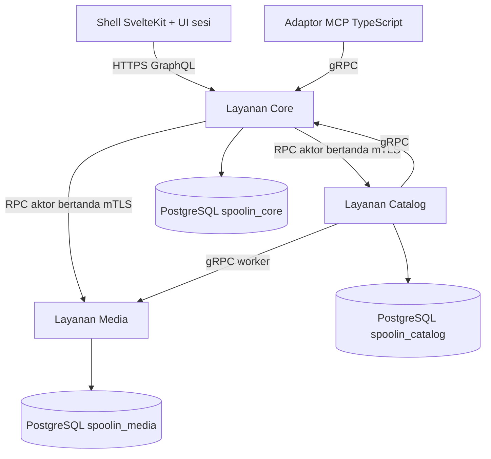

# SpoolIn: Arsitektur Platform Katalog Multi-Layanan

## Apa yang Dibangun

[SpoolIn](https://github.com/okfriansyah-moh/spoolIn) adalah katalog film dan televisi lokal
dengan pencarian, filter, detail pemeran dan kru, manajemen artwork, riwayat audit, serta
**pembuatan film berbantuan AI melalui MCP** (Model Context Protocol) yang disetujui manusia.
Repositori publik dirilis pada **2026-10-15** dengan spesifikasi desain teknis lengkap
(`docs/04-spoolin-techdoc.md`) dan **fondasi yang dapat direproduksi** dari
[PR #1 yang digabung](https://github.com/okfriansyah-moh/spoolIn/pull/1) (Tugas T001–T003).

Fondasi tersebut mengunci toolchain, menghasilkan kontrak wire bersama, dan menjalankan tiga
layanan Kotlin/Spring Boot — **Core**, **Catalog**, dan **Media** — masing-masing dengan basis
data PostgreSQL sendiri, URL JDBC terverifikasi TLS, listener gRPC mTLS privat, migrasi Flyway
terserialisasi, dan kesehatan gRPC yang tetap `NOT_SERVING` sampai validasi skema lulus.

Merge berikutnya memperluas stack di atas fondasi backend:

- [PR #4](https://github.com/okfriansyah-moh/spoolIn/pull/4) (T004–T005) — **shell aplikasi SvelteKit** bersama dengan navigasi bertema dan aksesibel serta **penyimpanan akun terlindungi** di Core (identitas terenkripsi, hashing kredensial Argon2, tes integrasi PostgreSQL).
- [PR #6](https://github.com/okfriansyah-moh/spoolIn/pull/6) (T006–T010, cakupan T007) — **registrasi dan sesi otoritatif**, semantik **kebijakan input efektif**, **tanda terima pemilik** dengan bukti mutasi atomik, **identitas layanan ber-scope dan admission bersama** di Core/Catalog/Media, plus perjalanan browser daftar/masuk/keluar.
- [PR #8](https://github.com/okfriansyah-moh/spoolIn/pull/8) (T006–T026, G04–G16) — **baca katalog publik dan UI discovery**, **draft terenkripsi** dengan kontroler browser, **tulisan film/orang/kredit otoritatif** dan editor maintainer, **alur unggah artwork** dengan hold dan lampiran, plus **siklus hidup arsip/pulihkan** dan UI progres artwork (tugas rencana *implementasi selesai*; penerimaan seleksi formal ditunda ke G26).
- [PR #9](https://github.com/okfriansyah-moh/spoolIn/pull/9) (T027–T046, G17–G26) — **pemulihan draft di editor** (`draft-sync`), **transport HTTP MCP yang dapat distream**, **proposal film immutable** dengan **ikatan persetujuan eksak** (tantangan UI hanya di `_meta.ui` MCP, bukan dari teks model), **sumber daya tinjauan dalam chat tepercaya**, UI **audit hanya-baca**, **manifest seed 100+100 beku** dengan CLI replay, **diagnostik JSON aman**, skrip **ops siklus hidup** yang dapat direproduksi, dan matriks **serah terima rilis** (`docs/release/g01-g26-closure-matrix.md`). Review independen menutup temuan sumber wajib; **penerimaan runtime** (matriks Playwright, klien MCP hidup, stack Compose) masih terbuka menurut bukti PR.
- [PR #10](https://github.com/okfriansyah-moh/spoolIn/pull/10) — **README instalasi pemula** (Windows/WSL2, macOS, Ubuntu), panduan stakeholder bergambar, alur **`local-*` Make** di Docker dengan kredensial/data yang dipertahankan, **penyegaran presentasi** sesuai mockup gelap/terang yang disetujui, **perbaikan UUID string audit GraphQL** (History tidak lagi mengembalikan objek UUID Java mentah), dan **routing fallback HTML** untuk deep link `/manage/`. Termasuk **jalur penerimaan remote parsial** di Ubuntu ter-host GitHub (replay seed, jalur MCP stdio→HTTP→mTLS, asersi monitoring) yang masih gagal satu kasus Playwright dan menunda gerbang delivery yang lebih luas.
- [PR #11](https://github.com/okfriansyah-moh/spoolIn/pull/11) — **pengerasan UX katalog maintainer**: filter dari judul aktif, viewport katalog stabil saat filter berubah, pencarian daftar manajemen dengan paginasi, **panel kembali setelah rekaman dibuat**, navigasi **Cast and creators** terpisah, **PersonSearchSelect** terpadu, **resize/siapkan artwork** di klien dengan penolakan dimensi terminal, **pemulihan scroll pencarian daftar** lewat token session storage yang tervalidasi, **`make local-repair-accounts`**, dan alur **Simpan film / Simpan orang** terkonfirmasi dengan isu field dari server.
- [PR #12](https://github.com/okfriansyah-moh/spoolIn/pull/12) — **walkthrough Maintainer di README** dan tangkapan layar disegarkan agar sesuai UI yang sudah digabung (hanya dokumentasi di repositori aplikasi).
- [PR #13](https://github.com/okfriansyah-moh/spoolIn/pull/13) — **modul kontroler reaktif Svelte 5** untuk delapan alur sesi/katalog/maintainer: kontroler pindah ke kelas `*.svelte.ts` dengan snapshot `$state.raw`, rute mengikat lewat `$derived` alih-alih loop subscribe/salin manual, dan `dispose()` eksplisit tetap ada. Tanpa perubahan Python, GraphQL, atau desain visual; bukti PR melaporkan tangkapan layar sebelum/sesudah identik piksel dan cakupan unit/DOM yang diperluas.
- [PR #14](https://github.com/okfriansyah-moh/spoolIn/pull/14) — **poster film yang disiapkan**, **kredit pemeran/kru opsional pada proposal**, dan **antrean tinjauan gabungan MCP/browser** (`movie_review_queue`) di mana setiap film tertunda menampilkan poster, kontrol keputusan revisi eksak, dan status penyelesaian. Kredit masuk **digest proposal immutable** (proposal tanpa kredit mempertahankan hash sebelumnya); orang dan kredit baru ditulis saat persetujuan Maintainer dalam transaksi film. Maintainer browser meninjau payload immutable yang sama di sesi masuk dengan **perlindungan CSRF**. Migrasi Catalog **V023–V025** menambah tabel persiapan poster dan kolom kredit; skema JSON MCP mengekspos bentuk antrean untuk penemuan alat. Commit lanjutan mendaftarkan **`ListMovieProposals`** dengan autentikasi aktor Catalog dan skrip perbaikan operator terbatas untuk film tersimpan lama (jalur perbaikan data, bukan backfill otomatis).
- [PR #16](https://github.com/okfriansyah-moh/spoolIn/pull/16) — **hygiene repositori tanpa redesign produk**: keempat prompt proyek berada di `docs/prompts/` (pohon lama `docs/prompt/` dihapus), modul review MCP dan helper seed Catalog yang tidak terpakai dihapus setelah cek konsumen, dan **state list-return bersama** dikonsolidasikan ke `frontend/src/lib/state/list-return.ts` untuk alur maintainer film dan person. SpoolIn mem-pin **bundle agent-workflow 1.3.0** (termasuk [kebijakan reuse berbasis implementasi](https://github.com/okfriansyah-moh/agentic-workflow/blob/main/docs/DELIVERY.md#reuse-and-evidence-based-cleanup) bersama) lewat updater resmi; skill lokal menautkan kebijakan itu alih-alih menyalin aturan pembersihan. Verifikasi baru `repository-hygiene.mjs` mengodekan penempatan prompt dan aturan tautan lokal. Bukti PR melaporkan hygiene dan empat kasus regresi lulus; suite static/type frontend penuh **terblokir tekanan memori host** saat merge.

Artikel ini membedakan **bukti sumber yang sudah digabung** dari **bukti runtime yang masih tertunda**
di matriks penutupan G01–G26 (termasuk jalur parsial dari PR #10).

## Masalah

Katalog media pribadi yang mendukung maintainer, viewer, dan pembuatan lewat MCP tidak aman
jika hidup di satu basis data monolit atau satu peran SQL bersama:

1. **Integritas katalog** — aturan visibilitas publik harus tetap berlaku meski Core salah konfigurasi.
2. **Isolasi artwork** — media biner dan reservasi tidak boleh berbagi kredensial SQL dengan metadata judul.
3. **Drift kontrak** — GraphQL browser, gRPC antar layanan, skema kebijakan JSON, dan payload MCP
   harus kompatibel di konsumen Kotlin dan TypeScript.
4. **Operabilitas lokal** — operator solo butuh build yang dapat direproduksi, startup satu perintah,
   dan probe kesiapan yang jujur sebelum HTTPS di loopback.

## Mengapa Masalah Ini Sulit

1. **Tiga basis data, tanpa SQL lintas layanan** — setiap layanan memiliki migrasi dan pool runtime;
   koordinasi hanya lewat RPC bertipe.
2. **Default keamanan** — PostgreSQL memakai `sslmode=verify-full`, rahasia berbasis file mode `0600`,
   dan metode gRPC dipetakan ke identitas sertifikat pemanggil.
3. **Keamanan migrasi** — hanya satu migrator yang boleh memegang kunci advisory; pod runtime menolak
   serve jika Flyway melaporkan migrasi tertunda atau versi di luar rentang.
4. **Kontrak yang dihasilkan** — SDL GraphQL, layanan protobuf, dan skema JSON harus ter-generate
   identik di CI dan mesin pengembang (22 pasang output cocok dalam bukti PR).
5. **Jalur persetujuan MCP mendatang** — proposal film exact-content tidak boleh melewati otorisasi
   Maintainer; desain mencadangkan RPC `McpGatewayService` dengan identitas pemanggil khusus MCP.

## Model Mental untuk Pemula

Bayangkan tiga toko spesialis di satu jalan:

- **Core** adalah meja depan — sesi, gateway, dan (nantinya) GraphQL untuk browser.
- **Catalog** adalah buku inventaris — judul, orang, kredit, audit; tidak masuk ruang penyimpanan Media.
- **Media** adalah bengkel bingkai — byte artwork dan reservasi; konfirmasi hold lewat RPC, bukan tabel bersama.

**Menu** dilaminasi (`contracts/graphql`, `contracts/grpc`, `contracts/json`) difotokopi untuk
setiap toko agar tidak ada yang mengimprovisasi bentuk pesan.

## Persyaratan dan Kendala

| Persyaratan | Bukti di repositori |
| ----------- | ------------------- |
| Build JVM/Node yang dapat direproduksi | Metadata verifikasi Gradle terkunci, image terpin, harness T001 |
| Kontrak bersama | `contracts/graphql/schema.graphql`, protobuf gRPC, skema JSON |
| Basis data milik layanan | URL JDBC `spoolin_core`, `spoolin_catalog`, `spoolin_media` di `ops/compose.yaml` |
| Peran DB least-privilege | Pengguna `runtime` vs `migrator` per layanan (`DatabaseSettings` di Core) |
| Transport mTLS privat | Sertifikat layanan, `ServiceIdentityInterceptor`, SAN `core/catalog/media/mcp` |
| Kesiapan yang jujur | `SchemaReadiness` + `HealthStatusManager` gRPC sampai migrasi valid |
| Deployment Compose lokal | `ops/compose.yaml` dengan container read-only, capability diturunkan, HTTPS loopback |
| Metrik hanya operator | Rute Actuator memerlukan identitas sertifikat klien (`ListenerBoundary`) |

## Gambaran Arsitektur

Runtime target (techdoc §2) dengan **layanan fondasi** yang diimplementasikan:



PR #1 menyampaikan tiga aplikasi backend, pipeline generasi kontrak, image Postgres, dan wiring
Compose. PR #4 menambahkan shell frontend statis yang disajikan Core; PR #6 menghubungkan operasi
GraphQL sesi, komponen panduan kebijakan, dan admission lintas layanan lewat pustaka identitas
`backend-support`. PR #8 menghubungkan penjelajahan katalog, jalur tulis maintainer, draft, dan
perjalanan artwork end-to-end di sumber. PR #9 menutup jalur proposal MCP → tinjauan →
setujui/tolak gateway di kode dan menambahkan alat seed/ops — dengan celah eksplisit untuk token
konektor dari host dan penerimaan klien penuh (T038–T039).

## Alur Eksekusi

### 1. Generasi kontrak (T002)

1. Engineer mengedit sumber kanonik di `contracts/`.
2. `build-tools/generate-*.mjs` memancarkan Java, TypeScript, dan fixture verifikasi.
3. Tes konsumen membuktikan batas pengetikan ketat.

### 2. Build image dan kunci dependensi (T001)

1. Metadata verifikasi Gradle mengunci hash dependensi.
2. Image container (`spoolin-*-foundation`) dibangun dari `ops/containers/*.Dockerfile`.
3. Tes harness memastikan dua build bersih menghasilkan artefak identik.

### 3. Persiapan basis data dan migrasi (T003)

1. Container Postgres menginisialisasi basis data dan peran per layanan dari file rahasia.
2. `core-migrator` (profil Compose `migration`) menjalankan `Application --migrate`.
3. `MigrationRunner` mengambil `pg_advisory_lock(1936749166)`, menjalankan Flyway pada skema `appdata`,
   memvalidasi, lalu melepaskan kunci.
4. Pod runtime `core` start hanya ketika `SchemaReadiness` melihat versi saat ini dalam min/max
   yang dikonfigurasi dan tidak ada migrasi tertunda.

### 4. Dispatch RPC terlindungi (fondasi)

1. Server gRPC menyajikan sertifikat layanan; SAN sertifikat peer memetakan identitas.
2. `ServiceIdentityInterceptor` hanya mengizinkan set pemanggil yang dikonfigurasi per metode.
3. Pemeriksaan kesehatan menerima identitas `core`, `catalog`, `media`, `mcp`, atau `operator`.

### 5. Shell aksesibel dan tema (T004 — PR #4)

1. Rute SvelteKit dipasang di `AppShell` dengan skip link, header merek, dan navigasi sadar kapabilitas.
2. Preferensi tema disimpan di browser storage dengan fallback skema warna sistem.
3. Komponen design-system bersama (`Field`, `ConfirmDialog`, `SessionBoundary`, dll.) menyiapkan fokus dan ringkasan error yang konsisten.

### 6. Persistensi akun terlindungi (T005 — PR #4)

1. Identitas maintainer/viewer disimpan di tabel milik Core dengan **payload terenkripsi** dan hashing Argon2 terbatas untuk rahasia.
2. Uniqueness lookup email dan normalisasi IDNA2008 berjalan sebelum persistensi.
3. Tes integrasi mencakup rotasi nonce, pemulihan setelah crash, dan batas kredensial berbasis PostgreSQL.

### 7. Sesi, kebijakan, tanda terima, dan admission (T006–T010 — PR #6)

1. Form browser mengirim operasi GraphQL (`register`, `sign-in`, `sign-out`, `bootstrap`) lewat lapisan transport bertipe dengan hasil dan validasi yang di-parse.
2. **Kebijakan input efektif** mengembalikan panduan per field (`PolicyGuidance`) agar klien menampilkan semantik yang sama dengan penegakan server Core.
3. **Tanda terima pemilik** mengikat mutasi katalog ke bukti durable dalam transaksi basis data yang sama dengan tulisan domain.
4. `libraries/backend-support` menandatangani **assertion aktor**; Catalog dan Media memverifikasi izin ber-scope sebelum RPC terlindungi.
5. Menu sesi dan rute manage menghubungkan shell ke state sesi Core.

### 8. Jelajah katalog, draft, dan tulisan maintainer (T011–T026 — PR #8)

1. Baca GraphQL publik (`titles`, `title`, `people`) mem-proxy lewat Core ke gRPC Catalog dengan aturan visibilitas.
2. **Draft terlindungi** menyimpan WIP maintainer terenkripsi; helper browser mengisolasi draft per akun.
3. **Tulisan film, orang, dan kredit** di Catalog dengan tanda terima pemilik; rute manage SvelteKit menghubungkan editor ke GraphQL terkelola.
4. **Artwork** mengalirkan unggahan ke Media, mengoordinasikan hold/reservasi, dan menampilkan progres di shell.
5. RPC **arsip/pulihkan/hapus** berpasangan dengan UI konfirmasi di rute manage.

### 9. Pemulihan draft di editor (T027 — PR #9)

1. Modul `draft-sync.ts` merekonsiliasi state editor lokal dengan draft server setelah gangguan (panel film, orang, kredit).
2. Tes unit mengunci bentuk pemulihan yang diharapkan; bukti pemulihan browser penuh masih *tertunda* di matriks penutupan.

### 10. MCP propose → persetujuan eksak → UI tinjauan (T028–T030 — PR #9)

1. Gateway MCP TypeScript mengekspos stub transport **HTTP dapat distream** dan penanganan bearer konektor.
2. **`ProposalWrites`** Catalog menyimpan baris proposal immutable; **`ExactApprovalBinding`** mengikat aksi setujui ke tantangan UI terikat.
3. Hasil alat `propose_movie` **menghapus** `ui_binding_token` dari konten terstruktur model; tantangan hanya di `_meta.ui` dengan `visibility: app`.
4. Frame tinjauan (`mcp/src/review/*`) mengambil tantangan via token ikatan; Core menambahkan `/gateway/approve_movie` dan `/gateway/reject_movie` dengan verifikasi bearer konektor.
5. **Belum dibuktikan di lane:** penandatanganan `MCP_UI_ASSERTION`, forward gRPC hidup MCP ke gateway, harness klien Claude Desktop / ChatGPT.

### 11. Seed, audit, diagnostik, dan ops siklus hidup (T031–T037 — PR #9)

1. **Baca audit** mengekspos hasil hanya-baca; rute `manage/audit` memakai GraphQL `audit`.
2. **`data/seed/manifest.json`** membekukan 100 film + 100 serial; `validate_manifest.py` memvalidasi jumlah di CI/lane.
3. **`CatalogSeedLoader`** dan `ops/bin/seed.sh` mendukung init/replay dengan semantik tanda terima.
4. **`SafeJsonDiagnostics`** dan konverter log meredaksi token ikatan dari log JSON.
5. Skrip **`ops/bin/`** (`start`, `stop`, `backup`, `restore`, `rotate-keys`, `logs`, …); `make start` gagal tertutup tanpa `SPOOLIN_LOCK_DIR`.

### 12. Dok instalasi, presentasi, dan perbaikan penerimaan (PR #10)

1. `README.md` root menambahkan jalur instalasi per platform, walkthrough tangkapan sintetis, dan target `local-*` yang membangun toolchain terpin di Docker sambil menjaga cache dependensi host di volume.
2. Token/layout frontend menyelaraskan hero katalog publik, grid poster, dan workspace manajemen dengan mockup yang disetujui tanpa mengubah kontrak GraphQL.
3. Resolver audit GraphQL mengembalikan **UUID string** untuk `subjectId` dan `operationId`; Core menyajikan catch-all SPA untuk navigasi HTML di `/manage/` sementara rute rekaman tetap otoritatif.
4. Bukti jalur remote (Actions di Ubuntu) mereplay jumlah seed beku, menjalankan jalur konektor MCP nyata, dan melaporkan satu kegagalan browser (`Create movie` masih aktif setelah simpan) plus batas Bubblewrap/proc mount — bukan penerimaan G26 penuh.

### 13. Alur kerja maintainer dan stabilitas katalog (PR #11)

1. **CatalogFilters** menurunkan pilihan genre/tahun/bulan dari judul aktif; riwayat shallow menghindari lompatan scroll saat hasil menyusut.
2. Kontroler daftar **Movies / Manage people** menambahkan pencarian berlabel, Enter, pencocokan partial case-insensitive, dan `Load more` tanpa mencuri fokus.
3. Alur buat film melalui **Add cast and creators**; **CreditPanel** + **PersonSearchSelect** menyatukan pemilih orang; peran kustom di belakang **RoleCreator** opsional.
4. **ArtworkUploadField** mendekode dengan `createImageBitmap`, mengecilkan dalam batas byte/dimensi di klien, dan memetakan penolakan Media terminal ke alasan yang terlihat operator.
5. Token **list-return.ts** di session storage memulihkan pencarian draft, kedalaman muatan, dan scroll setelah perjalanan kredit/simpan; kegagalan kembali ke navigasi biasa.
6. **`make local-repair-accounts`** meng-hash ulang kata sandi Viewer/Maintainer dari manifest yang disiapkan dalam satu transaksi sambil mencabut sesi (startup tetap mempertahankan kata sandi).

### 14. Penyegaran dokumentasi maintainer (PR #12)

1. `README.md` di repositori sumber memperbarui langkah Maintainer (penempatan artwork, halaman kredit, kontrol orang dapat dicari) dan mengganti aset PNG walkthrough — tanpa perubahan perilaku Kotlin/TypeScript.

### 15. Kontroler reaktif Svelte 5 (PR #13)

1. Delapan kontroler browser berganti nama menjadi modul `*.svelte.ts` (sesi, draft, jelajah katalog, daftar/editor film, daftar/editor orang, unggah artwork) sehingga **state reaktif hidup di dalam kelas kontroler** lewat `$state.raw`, dengan getter `snapshot` hanya-baca.
2. Rute SvelteKit dan komponen fitur **menderivasikan state UI** dengan `$derived(controller?.snapshot ?? INITIAL_…)` alih-alih memelihara salinan `$state` paralel yang diisi listener `subscribe`.
3. Hook penyelesaian (`onSaved`, `onCredentialReset`) menggantikan beberapa jalur unsubscribe; `onMount` tetap membangun kontroler dan memanggil `dispose()` saat teardown agar abort controller GraphQL yang sedang berjalan tetap terbatas.
4. Ekstraksi kecil (`uploadMessage`, `preparationError`, helper `list-return`) membersihkan pemblokir tipe/lint frontend; ESLint memperlakukan `**/*.svelte.ts` seperti sumber Svelte. Kontrak transport, data tersimpan, dan tata letak yang dirender tidak berubah menurut catatan blast-radius PR.

### 16. Poster, kredit proposal, dan tinjauan gabungan (PR #14)

1. **`prepare_movie_poster`** (MCP) menyimpan kandidat artwork; **`propose_movie`** melampirkan metadata, kredit opsional, dan referensi poster yang disiapkan sebelum antrean tinjauan.
2. **`PreparedMoviePosters`** dan **`ProposalCredits`** di Catalog memperluas baris draft/proposal; Flyway **V023–V025** memigrasikan kolom poster dan kredit dengan catatan rollback aditif di PR.
3. Digest **`ProposalContent`** mencakup kredit yang dinormalisasi; proposal **tanpa kredit** mempertahankan hash kompatibel dengan revisi sebelumnya agar persetujuan basi tidak mengikat payload yang berubah.
4. **`movie_review_queue`** MCP mengembalikan proposal milik yang persisten bersama — setiap entri membawa pratinjau poster, kontrol persetujuan eksak per film, dan metadata penyelesaian privat; skema output antrean disematkan untuk penemuan alat MCP.
5. Tinjauan dalam chat (`mcp/src/review/*`) dan browser **`/manage/proposals/[id]`** merender isi proposal immutable yang sama; aksi browser memakai cookie sesi Maintainer plus token CSRF pada mutasi tinjauan.
6. Saat disetujui, Catalog menulis **orang dan kredit dalam transaksi film**, lalu menyelesaikan lampiran poster aman-retry pada operasi yang persisten; proposal kedaluwarsa menghormati **TTL 24 jam** di gelombang ini.
7. **`ListMovieProposals`** terdaftar di gRPC Catalog dengan pola autentikasi aktor yang sama seperti RPC proposal terlindungi lainnya (lanjutan `65f594ec`).

## Komponen Penting

| Komponen | Tanggung jawab |
| -------- | --------------- |
| `build-tools/generate-contracts.mjs` | Mengorkestrasi generasi GraphQL, protobuf, JSON, token |
| `contracts/grpc/spoolin/v1/spoolin.proto` | Permukaan API gRPC |
| `frontend/src/lib/components/AppShell.svelte` | Shell aksesibel, tema, navigasi sadar kapabilitas (T004) |
| `services/core/.../ProtectedAccounts.kt` | Identitas akun terenkripsi dan penyimpanan kredensial (T005) |
| `services/core` | Gateway GraphQL sesi, entrypoint MCP, hosting frontend statis |
| `frontend/src/lib/features/session/*` | Kontroler registrasi/masuk/keluar dan dokumen GraphQL (T006–T007) |
| `frontend/src/lib/policy/*` | Parsing kebijakan efektif dan panduan UI (T009) |
| `libraries/backend-support` | Penandatanganan aktor, file trust, izin ber-scope, admission (T008) |
| `services/catalog` | Layanan domain katalog dengan penegakan admission bersama |
| `services/media` | Layanan artwork dengan penegakan admission bersama |
| `ops/compose.yaml` | Jaringan privat, rahasia, profil migrator, publish port loopback |
| `MigrationRunner` / `SchemaReadiness` | Migrasi terserialisasi dan gerbang serving |
| `ServiceIdentityInterceptor` | Identitas mTLS ke allowlist metode |
| `frontend/src/lib/features/catalog/*` | UI discovery dan baca katalog publik (T012–T013) |
| `frontend/src/lib/features/*/draft-sync.ts` | Pemulihan draft editor setelah gangguan (T027) |
| `services/catalog/.../ProposalWrites.kt` | Proposal film MCP immutable dan ikatan persetujuan eksak (T029) |
| `mcp/src/review/*` | Sumber daya tinjauan dalam chat tepercaya (T030) |
| `build-tools/validate-seed/*` | Generasi dan validasi manifest seed beku (T032) |
| `ops/bin/*.sh` | Perintah operator siklus hidup (T037) |
| `docs/release/g01-g26-closure-matrix.md` | Status penutupan sumber vs runtime per tugas (T046) |
| `docs/04-spoolin-techdoc.md` | Desain otoritatif untuk siklus hidup, persetujuan MCP, pekerjaan durable |
| `frontend/src/lib/components/CatalogFilters.svelte` | Pilihan filter dari judul aktif dan navigasi katalog stabil (PR #11) |
| `frontend/src/lib/features/credit/PersonSearchSelect.svelte` | Pemilih orang dapat dicari terpadu untuk kredit (PR #11) |
| `frontend/src/lib/features/movie/list-return.ts` | Token kembali session storage untuk pemulihan scroll/pencarian daftar (PR #11) |
| `frontend/src/lib/features/artwork/prepare-file.ts` | Resize/dekode klien sebelum unggah artwork (PR #11) |
| `Makefile` (`local-repair-accounts`) | Perbaikan kata sandi operator terikat manifest yang disiapkan (PR #11) |
| `frontend/src/lib/features/*/*.svelte.ts` | Modul kontroler reaktif Svelte 5 dengan `snapshot` + `dispose()` (PR #13) |
| `mcp/src/tools/poster-import.ts` / `poster-output.ts` | Persiapan poster MCP dan field poster terstruktur pada hasil alat (PR #14) |
| `services/catalog/.../PreparedMoviePosters.kt` | Menyimpan handle artwork yang disiapkan sebelum persetujuan proposal (PR #14) |
| `services/catalog/.../ProposalCredits.kt` | Baris pemeran/kru dinormalisasi terikat proposal immutable (PR #14) |
| `mcp/src/review/presentation.ts` | Tata letak antrean gabungan dengan krom keputusan per film (PR #14) |
| `frontend/src/lib/features/proposal/api.ts` | Klien GraphQL Maintainer untuk tinjauan proposal browser (PR #14) |
| `frontend/src/routes/manage/proposals/[id]/+page.svelte` | UI tinjauan proposal masuk dengan aksi sadar CSRF (PR #14) |
| `contracts/json/mcp-outputs.schema.json` | Definisi skema `movie_review_queue` untuk penemuan MCP (PR #14) |

## Contoh Implementasi yang Disederhanakan

Disederhanakan dari `DatabaseSettings.validateUrl`:

```kotlin
require(url.startsWith("jdbc:postgresql://"))
require(uri.path == "/spoolin_$owner" && uri.userInfo == null)
require(parameters.any { it == listOf("sslmode", "verify-full") })
```

Gerbang migrasi:

```kotlin
fun ready(): Boolean {
  val flyway = ownerFlyway(dataSource)
  val current = flyway.info().current() ?: return false
  return current.version in minimumVersion..maximumVersion &&
    flyway.info().pending().isEmpty() &&
    flyway.validateWithResult().validationSuccessful
}
```

Contoh ikatan kontroler Svelte 5 (dari `ArtworkUploadField.svelte` setelah PR #13):

```typescript
// controller.svelte.ts — snapshot reaktif di dalam kelas
export class ArtworkUploadController {
  private view = $state.raw(INITIAL_ARTWORK_UPLOAD_VIEW);
  get snapshot() {
    return this.view;
  }
}

// komponen — derived alih-alih subscribe + salin
const view = $derived(controller?.snapshot ?? INITIAL_ARTWORK_UPLOAD_VIEW);
```

## Keandalan dan Idempotensi

- **Migrasi** — kunci advisory mencegah migrator konkuren; Flyway `cleanDisabled(true)` memblokir reset destruktif.
- **Kesiapan** — kesehatan gRPC menjadi `SERVING` hanya saat validasi skema berhasil.
- **Pekerjaan durable (desain)** — techdoc §7 mendefinisikan job tersimpan untuk efek lintas layanan tanpa transaksi terdistribusi.
- **Operasi klien idempoten (desain)** — mutasi GraphQL membawa UUID operasi untuk submit ulang aman setelah jaringan putus.
- **Kredit proposal (PR #14)** — kredit memengaruhi digest immutable hanya saat tertunda; baris orang/kredit yang disetujui dikomit atomik dengan film agar publikasi parsial tidak meninggalkan pemeran yatim.
- **Lampiran poster (PR #14)** — handle poster yang disiapkan direkonsiliasi lewat jalur receipt operasi persisten sehingga retry setelah persetujuan tidak membuat tautan artwork duplikat.

## Mode Kegagalan

| Kegagalan | Deteksi | Pemulihan |
| --------- | ------- | --------- |
| Migrasi tertunda | `SchemaReadiness` down | Jalankan profil migrator |
| Kontensi kunci | Batas migrasi terlampaui | Ulangi migrator; periksa sesi macet |
| Peran DB salah | `require` startup | Perbaiki rahasia Compose / env |
| Pemanggil gRPC tidak sah | `PERMISSION_DENIED` | Rotasi sertifikat; perbaiki SAN |
| Izin file rahasia | `requireProtectedFile` gagal | chmod `600`, rahasia satu baris |
| Media tidak tersedia saat baca (desain) | Core menurunkan URL artwork | Metadata katalog tetap kembali |
| Persiapan poster gagal sebelum propose (PR #14) | Alat MCP mengembalikan kegagalan terstruktur | Operator perbaiki sumber artwork; proposal tidak diantrekan |
| Proposal kedaluwarsa (PR #14) | TTL habis pada baris antrean | Maintainer harus propose ulang; digest mencegah reuse diam-diam |
| Ketidakcocokan digest kredit (PR #14) | Ikatan persetujuan eksak menolak UI basi | Buka ulang entri antrean; tidak ada publikasi saat hash bergeser |

## Trade-off dan Alternatif yang Ditolak

| Keputusan | Alasan |
| --------- | ------ |
| Tiga basis data vs satu | Isolasi blast-radius; kepemilikan Flyway per layanan |
| Kontrak dihasilkan vs DTO manual | Mencegah drift GraphQL/protobuf |
| Mengecualikan auto-config GraphQL awal | Membuktikan transport/keamanan sebelum API browser |
| Layanan gRPC stub di PR #1 | Menguji identitas dan kesehatan tanpa logika katalog setengah jadi |
| Compose di loopback vs K8s cloud | Techdoc membatasi instalasi lokal pribadi |

## Pengujian

Bukti repositori:

- **T001 (PR #1)** — 32/32 pemeriksaan; dua build bersih → 22 pasang artefak cocok.
- **T002 (PR #1)** — 22/22 tes kontrak termasuk konsumen Java dan TypeScript ketat.
- **T003 (PR #1)** — 15 kasus batas PostgreSQL/mTLS/HTTP + 15 kasus aturan arsitektur.
- **T004–T005 (PR #4)** — 93 tes unit/komponen frontend terpilih, 32 kasus browser shell,
  17 unit + 25 tes perlindungan akun PostgreSQL (menurut tabel bukti PR).
- **T006–T010 (PR #6)** — 32 shell, 40 kebijakan, dan 23 kasus browser akun dilaporkan lulus;
  pemindaian Semgrep/Gitleaks/OSV dikonfigurasi di peta verifikasi.
- **T006–T026 (PR #8)** — dokumen rencana menandai tugas *implementasi selesai*; penulis PR menunda matriks Playwright/browser penuh secara lokal (batas resource host).
- **T027–T046 (PR #9)** — tes unit untuk proposal, state tinjauan, draft-sync, API audit, validator seed, dan meta UI MCP; `mcp tsc --noEmit` dan `validate_manifest.py` lulus di lane; IT Gradle, Compose, dan harness klien secara eksplisit dilewati sampai penerimaan runtime.
- **PR #10** — verifikasi Docker macOS (jelajah, edit, artwork, persistensi restart); `make local-test` melaporkan 42 pemeriksaan helper, 387 tes frontend, 76 tes MCP, dan tes Gradle lulus; jalur remote parsial menjalankan seed/MCP/monitoring dengan satu kegagalan Playwright dan melewati gerbang delivery yang lebih luas.
- **PR #11** — diff frontend/kontroler besar; bukti PR menyebut suite unit lulus dan walkthrough manual macOS untuk filter katalog, pencarian manajemen, navigasi kredit, dan persiapan artwork (tanpa perubahan skema publik).
- **PR #12** — hanya pemeriksaan kata dokumentasi; tangkapan layar disegarkan terhadap UI yang digabung.
- **PR #13** — 157 tes unit/DOM terfokus di 24 berkas plus delapan kasus smoke browser dengan fixture GraphQL terkontrol; tipe, lint, build, dan pemindaian dependensi lulus menurut bukti PR; enam tangkapan layar representatif dilaporkan identik piksel.
- **PR #14** — penulis PR melaporkan **tidak ada suite tes, lint, atau typecheck otomatis** yang dijalankan untuk merge ini; bukti mengandalkan review sumber independen, migrasi Catalog V025 lokal, rebuild image Docker, dan verifikasi MCP/browser manual pada tujuh proposal tertunda. Anggap cakupan runtime **belum diverifikasi** terhadap target 80% baris berubah repositori.

## Operasi dan Observabilitas

- **Perintah** — `Makefile` mengarahkan `start` ke `ops/bin/start.sh`; skrip siklus hidup di `ops/bin/`
  mencakup backup, restore, seed, rotasi kunci, log, dan helper konektor (PR #9).
- **Compose** — set `SPOOLIN_INSTALLATION`; HTTPS Core default `127.0.0.1:8443`.
- **Metrik** — Prometheus mengikis Actuator privat; `/actuator/prometheus` memerlukan sertifikat `prometheus`.

## Pelajaran yang Dipetik

1. **Buktikan transport dan gerbang skema sebelum fitur** — kesehatan yang bohong lebih buruk dari tetap merah sampai migrasi selesai.
2. **Anggap kontrak sebagai artefak yang dapat dikompilasi** — generasi + tes konsumen menangkap drift lebih awal.
3. **Enkode invarian keamanan di blok `require` startup** — bentuk URL JDBC dan mode file rahasia gagal cepat.
4. **Pertahankan persetujuan MCP di gateway Core** — memusatkan `McpGatewayService` menjaga otorisasi Maintainer.
5. **Jangan taruh rahasia persetujuan yang dapat ditukar di konten terstruktur yang terlihat model** — review PR #9 mewajibkan menghapus token ikatan dari hasil alat dan hanya menyajikan tantangan UI lewat metadata aplikasi MCP.
6. **Biarkan kontroler memiliki state reaktif di Svelte 5** — PR #13 menunjukkan snapshot `$derived` mengalahkan set listener buatan tangan saat UI harus identik dengan batas siklus hidup yang lebih jelas.
7. **Masukkan kredit ke digest proposal sejak awal** — PR #14 menjaga hash stabil untuk proposal tanpa kredit sambil tetap membiarkan maintainer meninjau pemeran/kru sebelum katalog publik.
8. **Satu antrean untuk chat dan browser** — berbagi bentuk `movie_review_queue` antara alat MCP dan UI Maintainer menghindari cerita persetujuan yang berbeda untuk payload immutable yang sama.
9. **Sentralisasi state UI lintas fitur sebelum menduplikasi helper** — PR #16 menunjukkan pemulihan scroll list-return cocok di satu modul dengan wrapper tipis per fitur.
10. **Tautkan kebijakan agent bersama, jangan fork** — bundle 1.3.0 membawa aturan reuse `DELIVERY.md`; teks khusus SpoolIn terbatas pada path prompt dan cek hygiene.

## Terkait

- [Ringkasan proyek SpoolIn](/id/docs/projects/spoolin)
- [Mesin status berbasis basis data](/id/docs/concepts/database-state-machines)
- [Guardrail LLM](/id/docs/concepts/llm-guardrails)
- [Reuse berbasis implementasi dan pembersihan berbasis bukti](/id/docs/concepts/implementation-first-reuse-and-cleanup)

## Sumber

- Repositori: [okfriansyah-moh/spoolIn](https://github.com/okfriansyah-moh/spoolIn)
- Pull request:
  - [#1](https://github.com/okfriansyah-moh/spoolIn/pull/1) (merge `83c40e9`)
  - [#4](https://github.com/okfriansyah-moh/spoolIn/pull/4) (merge `1d0f96b`)
  - [#6](https://github.com/okfriansyah-moh/spoolIn/pull/6) (merge `ffcaae5`)
  - [#8](https://github.com/okfriansyah-moh/spoolIn/pull/8) (merge `053eb8a`)
  - [#9](https://github.com/okfriansyah-moh/spoolIn/pull/9) (merge `2764ca8`)
  - [#10](https://github.com/okfriansyah-moh/spoolIn/pull/10) (merge `71430bd`)
  - [#11](https://github.com/okfriansyah-moh/spoolIn/pull/11) (merge `929bfdb`)
  - [#12](https://github.com/okfriansyah-moh/spoolIn/pull/12) (merge `0b5348b`)
  - [#13](https://github.com/okfriansyah-moh/spoolIn/pull/13) (merge `d4b21d1`)
  - [#14 Poster MCP, kredit, dan tinjauan proposal gabungan](https://github.com/okfriansyah-moh/spoolIn/pull/14) (merge `6470702`)
  - [#16 Konsolidasi prompt dan hapus kode SpoolIn tidak terpakai](https://github.com/okfriansyah-moh/spoolIn/pull/16) (merge `5498f51`)
- Spesifikasi desain: `docs/04-spoolin-techdoc.md` (v1.11, Oktober 2026)
- Commit bukti PR #1: `12e487f001b66c2f3a5802654c6928849aa47c49`
