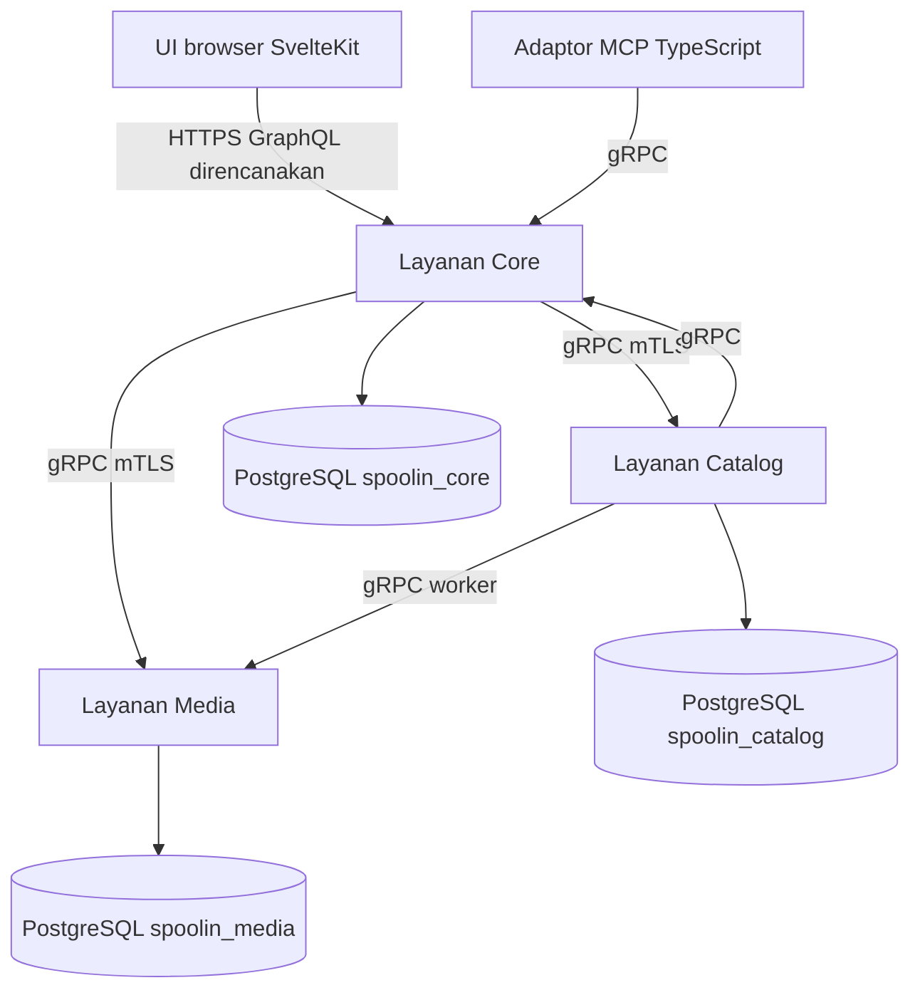

# SpoolIn: Arsitektur Platform Katalog Multi-Layanan

## Apa yang Dibangun

[SpoolIn](https://github.com/okfriansyah-moh/spoolIn) adalah katalog film dan televisi lokal
dengan pencarian, filter, detail pemeran dan kru, manajemen artwork, riwayat audit, serta
**pembuatan film berbantuan AI melalui MCP** (Model Context Protocol) yang disetujui manusia.
Repositori publik dirilis pada **2026-10-15** dengan spesifikasi desain teknis lengkap
(`docs/04-spoolin-techdoc.md`) dan **fondasi yang dapat direproduksi** dari
[PR #1 yang digabung](https://github.com/okfriansyah-moh/spoolIn/pull/1) (Tugas T001–T003).

Fondasi tersebut mengunci toolchain, menghasilkan kontrak wire bersama, dan menjalankan tiga
layanan Kotlin/Spring Boot — **Core**, **Catalog**, dan **Media** — masing-masing dengan basis
data PostgreSQL sendiri, URL JDBC terverifikasi TLS, listener gRPC mTLS privat, migrasi Flyway
terserialisasi, dan kesehatan gRPC yang tetap `NOT_SERVING` sampai validasi skema lulus.

Fitur produk berikutnya (shell GraphQL browser, mutasi katalog, runtime adaptor MCP) tercantum
di techdoc dan dilacak sebagai tugas implementasi; artikel ini membedakan **apa yang dibuktikan
PR #1 di kode** dari **target desain dokumen**.

## Masalah

Katalog media pribadi yang mendukung maintainer, viewer, dan pembuatan lewat MCP tidak aman
jika hidup di satu basis data monolit atau satu peran SQL bersama:

1. **Integritas katalog** — aturan visibilitas publik harus tetap berlaku meski Core salah konfigurasi.
2. **Isolasi artwork** — media biner dan reservasi tidak boleh berbagi kredensial SQL dengan metadata judul.
3. **Drift kontrak** — GraphQL browser, gRPC antar layanan, skema kebijakan JSON, dan payload MCP
   harus kompatibel di konsumen Kotlin dan TypeScript.
4. **Operabilitas lokal** — operator solo butuh build yang dapat direproduksi, startup satu perintah,
   dan probe kesiapan yang jujur sebelum HTTPS di loopback.

## Mengapa Masalah Ini Sulit

1. **Tiga basis data, tanpa SQL lintas layanan** — setiap layanan memiliki migrasi dan pool runtime;
   koordinasi hanya lewat RPC bertipe.
2. **Default keamanan** — PostgreSQL memakai `sslmode=verify-full`, rahasia berbasis file mode `0600`,
   dan metode gRPC dipetakan ke identitas sertifikat pemanggil.
3. **Keamanan migrasi** — hanya satu migrator yang boleh memegang kunci advisory; pod runtime menolak
   serve jika Flyway melaporkan migrasi tertunda atau versi di luar rentang.
4. **Kontrak yang dihasilkan** — SDL GraphQL, layanan protobuf, dan skema JSON harus ter-generate
   identik di CI dan mesin pengembang (22 pasang output cocok dalam bukti PR).
5. **Jalur persetujuan MCP mendatang** — proposal film exact-content tidak boleh melewati otorisasi
   Maintainer; desain mencadangkan RPC `McpGatewayService` dengan identitas pemanggil khusus MCP.

## Model Mental untuk Pemula

Bayangkan tiga toko spesialis di satu jalan:

- **Core** adalah meja depan — sesi, gateway, dan (nantinya) GraphQL untuk browser.
- **Catalog** adalah buku inventaris — judul, orang, kredit, audit; tidak masuk ruang penyimpanan Media.
- **Media** adalah bengkel bingkai — byte artwork dan reservasi; konfirmasi hold lewat RPC, bukan tabel bersama.

**Menu** dilaminasi (`contracts/graphql`, `contracts/grpc`, `contracts/json`) difotokopi untuk
setiap toko agar tidak ada yang mengimprovisasi bentuk pesan.

## Persyaratan dan Kendala

| Persyaratan | Bukti di repositori |
| ----------- | ------------------- |
| Build JVM/Node yang dapat direproduksi | Metadata verifikasi Gradle terkunci, image terpin, harness T001 |
| Kontrak bersama | `contracts/graphql/schema.graphql`, protobuf gRPC, skema JSON |
| Basis data milik layanan | URL JDBC `spoolin_core`, `spoolin_catalog`, `spoolin_media` di `ops/compose.yaml` |
| Peran DB least-privilege | Pengguna `runtime` vs `migrator` per layanan (`DatabaseSettings` di Core) |
| Transport mTLS privat | Sertifikat layanan, `ServiceIdentityInterceptor`, SAN `core/catalog/media/mcp` |
| Kesiapan yang jujur | `SchemaReadiness` + `HealthStatusManager` gRPC sampai migrasi valid |
| Deployment Compose lokal | `ops/compose.yaml` dengan container read-only, capability diturunkan, HTTPS loopback |
| Metrik hanya operator | Rute Actuator memerlukan identitas sertifikat klien (`ListenerBoundary`) |

## Gambaran Arsitektur

Runtime target (techdoc §2) dengan **layanan fondasi** yang diimplementasikan:



PR #1 menyampaikan tiga aplikasi backend, pipeline generasi kontrak, image Postgres, dan wiring
Compose; auto-konfigurasi GraphQL secara eksplisit dikecualikan di `@SpringBootApplication` Core
sampai tugas berikutnya mengaktifkan API browser.

## Alur Eksekusi

### 1. Generasi kontrak (T002)

1. Engineer mengedit sumber kanonik di `contracts/`.
2. `build-tools/generate-*.mjs` memancarkan Java, TypeScript, dan fixture verifikasi.
3. Tes konsumen membuktikan batas pengetikan ketat.

### 2. Build image dan kunci dependensi (T001)

1. Metadata verifikasi Gradle mengunci hash dependensi.
2. Image container (`spoolin-*-foundation`) dibangun dari `ops/containers/*.Dockerfile`.
3. Tes harness memastikan dua build bersih menghasilkan artefak identik.

### 3. Persiapan basis data dan migrasi (T003)

1. Container Postgres menginisialisasi basis data dan peran per layanan dari file rahasia.
2. `core-migrator` (profil Compose `migration`) menjalankan `Application --migrate`.
3. `MigrationRunner` mengambil `pg_advisory_lock(1936749166)`, menjalankan Flyway pada skema `appdata`,
   memvalidasi, lalu melepaskan kunci.
4. Pod runtime `core` start hanya ketika `SchemaReadiness` melihat versi saat ini dalam min/max
   yang dikonfigurasi dan tidak ada migrasi tertunda.

### 4. Dispatch RPC terlindungi (fondasi)

1. Server gRPC menyajikan sertifikat layanan; SAN sertifikat peer memetakan identitas.
2. `ServiceIdentityInterceptor` hanya mengizinkan set pemanggil yang dikonfigurasi per metode.
3. Pemeriksaan kesehatan menerima identitas `core`, `catalog`, `media`, `mcp`, atau `operator`.

### 5. Urutan baca/mutasi katalog (desain — techdoc §2.3)

Dirinci untuk tugas fitur mendatang: mutasi browser → Core → Catalog `CheckActor` → transaksi lokal
→ rekonsiliasi `GetOperation` jika respons hilang. Kode fondasi mendaftarkan layanan gRPC stub agar
aturan identitas dapat diuji sebelum logika bisnis selesai.

## Komponen Penting

| Komponen | Tanggung jawab |
| -------- | --------------- |
| `build-tools/generate-contracts.mjs` | Mengorkestrasi generasi GraphQL, protobuf, JSON, token |
| `contracts/grpc/spoolin/v1/spoolin.proto` | Permukaan API gRPC |
| `services/core` | Gateway akun, entrypoint MCP (stub), fixture navigasi HTTPS statis |
| `services/catalog` | Layanan domain katalog (tes batas fondasi) |
| `services/media` | Layanan artwork (tes batas fondasi) |
| `ops/compose.yaml` | Jaringan privat, rahasia, profil migrator, publish port loopback |
| `MigrationRunner` / `SchemaReadiness` | Migrasi terserialisasi dan gerbang serving |
| `ServiceIdentityInterceptor` | Identitas mTLS ke allowlist metode |
| `docs/04-spoolin-techdoc.md` | Desain otoritatif untuk siklus hidup, persetujuan MCP, pekerjaan durable |

## Contoh Implementasi yang Disederhanakan

Disederhanakan dari `DatabaseSettings.validateUrl`:

```kotlin
require(url.startsWith("jdbc:postgresql://"))
require(uri.path == "/spoolin_$owner" && uri.userInfo == null)
require(parameters.any { it == listOf("sslmode", "verify-full") })
```

Gerbang migrasi:

```kotlin
fun ready(): Boolean {
  val flyway = ownerFlyway(dataSource)
  val current = flyway.info().current() ?: return false
  return current.version in minimumVersion..maximumVersion &&
    flyway.info().pending().isEmpty() &&
    flyway.validateWithResult().validationSuccessful
}
```

## Keandalan dan Idempotensi

- **Migrasi** — kunci advisory mencegah migrator konkuren; Flyway `cleanDisabled(true)` memblokir reset destruktif.
- **Kesiapan** — kesehatan gRPC menjadi `SERVING` hanya saat validasi skema berhasil.
- **Pekerjaan durable (desain)** — techdoc §7 mendefinisikan job tersimpan untuk efek lintas layanan tanpa transaksi terdistribusi.
- **Operasi klien idempoten (desain)** — mutasi GraphQL membawa UUID operasi untuk submit ulang aman setelah jaringan putus.

## Mode Kegagalan

| Kegagalan | Deteksi | Pemulihan |
| --------- | ------- | --------- |
| Migrasi tertunda | `SchemaReadiness` down | Jalankan profil migrator |
| Kontensi kunci | Batas migrasi terlampaui | Ulangi migrator; periksa sesi macet |
| Peran DB salah | `require` startup | Perbaiki rahasia Compose / env |
| Pemanggil gRPC tidak sah | `PERMISSION_DENIED` | Rotasi sertifikat; perbaiki SAN |
| Izin file rahasia | `requireProtectedFile` gagal | chmod `600`, rahasia satu baris |
| Media tidak tersedia saat baca (desain) | Core menurunkan URL artwork | Metadata katalog tetap kembali |

## Trade-off dan Alternatif yang Ditolak

| Keputusan | Alasan |
| --------- | ------ |
| Tiga basis data vs satu | Isolasi blast-radius; kepemilikan Flyway per layanan |
| Kontrak dihasilkan vs DTO manual | Mencegah drift GraphQL/protobuf |
| Mengecualikan auto-config GraphQL awal | Membuktikan transport/keamanan sebelum API browser |
| Layanan gRPC stub di PR #1 | Menguji identitas dan kesehatan tanpa logika katalog setengah jadi |
| Compose di loopback vs K8s cloud | Techdoc membatasi instalasi lokal pribadi |

## Pengujian

Bukti PR #1:

- **T001** — 32/32 pemeriksaan; dua build bersih → 22 pasang artefak cocok.
- **T002** — 22/22 tes kontrak termasuk konsumen Java dan TypeScript ketat.
- **T003** — 15 kasus batas PostgreSQL/mTLS/HTTP + 15 kasus aturan arsitektur.

## Operasi dan Observabilitas

- **Perintah** — perintah publik `Makefile` (techdoc §11).
- **Compose** — set `SPOOLIN_INSTALLATION`; HTTPS Core default `127.0.0.1:8443`.
- **Metrik** — Prometheus mengikis Actuator privat; `/actuator/prometheus` memerlukan sertifikat `prometheus`.

## Pelajaran yang Dipetik

1. **Buktikan transport dan gerbang skema sebelum fitur** — kesehatan yang bohong lebih buruk dari tetap merah sampai migrasi selesai.
2. **Anggap kontrak sebagai artefak yang dapat dikompilasi** — generasi + tes konsumen menangkap drift lebih awal.
3. **Enkode invarian keamanan di blok `require` startup** — bentuk URL JDBC dan mode file rahasia gagal cepat.
4. **Pertahankan persetujuan MCP di gateway Core** — memusatkan `McpGatewayService` menjaga otorisasi Maintainer.

## Terkait

- [Ringkasan proyek SpoolIn](/id/docs/projects/spoolin)
- [Mesin status berbasis basis data](/id/docs/concepts/database-state-machines)
- [Guardrail LLM](/id/docs/concepts/llm-guardrails)

## Sumber

- Repositori: [okfriansyah-moh/spoolIn](https://github.com/okfriansyah-moh/spoolIn)
- Pull request: [#1](https://github.com/okfriansyah-moh/spoolIn/pull/1) (merge `83c40e9`)
- Spesifikasi desain: `docs/04-spoolin-techdoc.md` (v1.11, Oktober 2026)
- Commit bukti PR #1: `12e487f001b66c2f3a5802654c6928849aa47c49`
